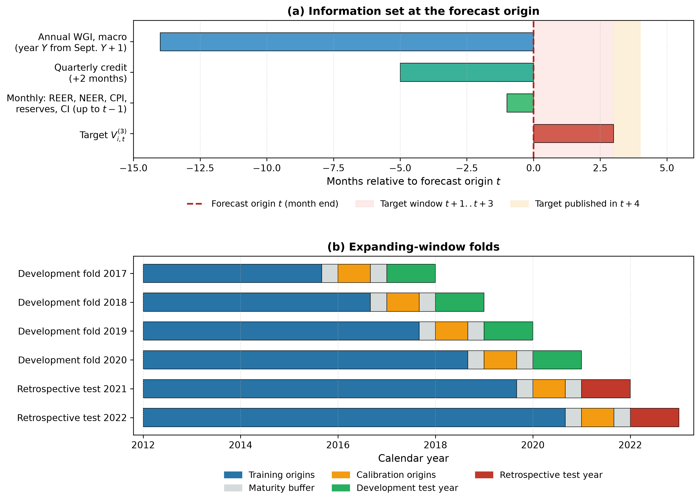
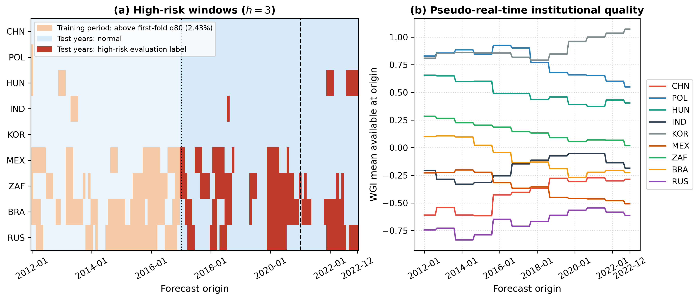
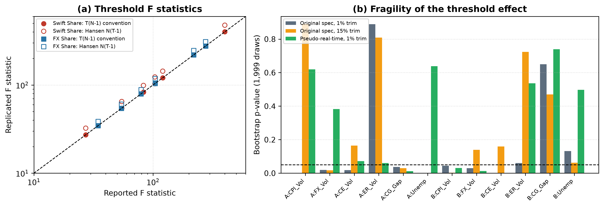
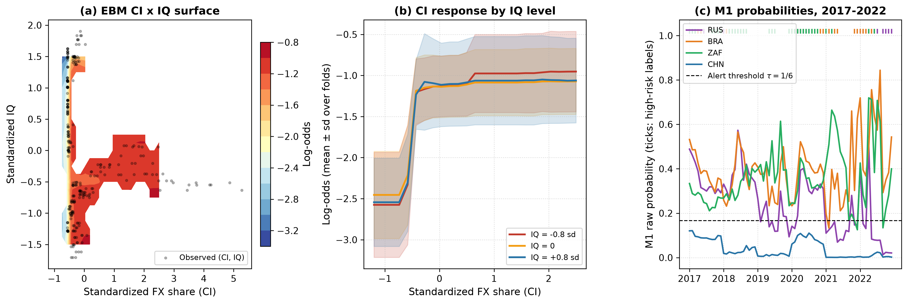
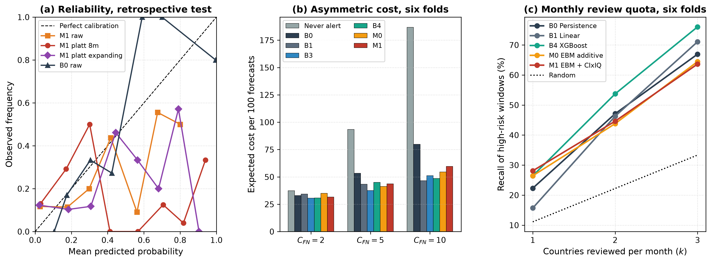
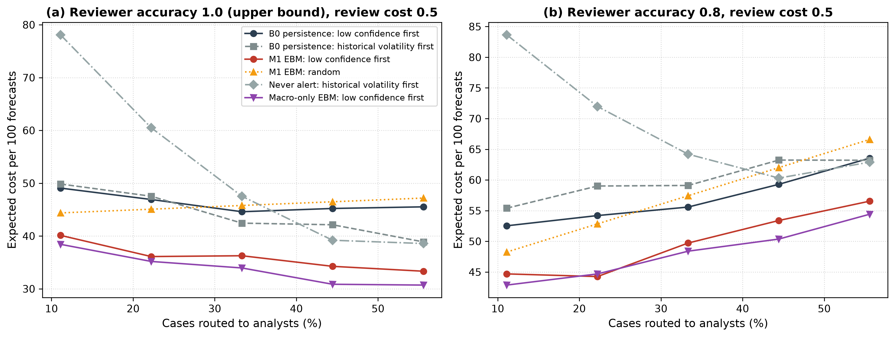

# Do institutional thresholds improve exchange-rate stress early warning? An auditable replication-to-prediction evaluation

## Abstract

Institutional thresholds estimated in panel regressions may motivate early-warning features without establishing their predictive or decision value. We present an auditable workflow linking internal replication, release-lag-adjusted prediction and decision-cost simulation. Across panels of six and nine emerging economies, a compatible calculation reproduces all 12 reported threshold F statistics, while 4 of 8 nominally significant tests lose significance under 15% trimming. The forecasting evaluation over 2017-2022 contains 121 high-risk real-effective-exchange-rate windows. In the main FX-share comparisons, only one of 18 currency-internationalization or institutional-quality additions, institutional quality in the additive model, reaches a point-estimate gain of 0.02 average precision (AP), with an interval that includes zero; 6 paired intervals cannot exclude such a gain. Equivalence between the institution-conditioned interaction and the additive model is not established. In 2021-2022, country identity plus persistence achieves AP 0.574, compared with 0.535 for persistence alone. Eight-month recalibration worsens Brier scores for all 7 benchmark models. Simulated review benefits depend on reviewer errors, fees and the comparison policy. In an exploratory 2023-2025 rerun with corrected tuning, institutional quality lowers the additive model's expected cost, but its AP interval includes zero, and XGBoost shows no detected increment. The refitted fallback retains persistence throughout, while corrected XGBoost achieves higher AP in the core economies. The findings support explicit audits of information timing and decision assumptions; they do not establish real-time deployment performance or a general absence of institutional information.

**Keywords:** Early warning system; Explainable boosting machine; Panel threshold regression; Replication; Pseudo-real-time evaluation; Selective prediction

## 1. Introduction

Early-warning systems for exchange-rate and balance-of-payments stress are decision-support tools. A model ranks countries or months by risk, and analysts decide where to spend limited monitoring capacity (Kaminsky et al., 1998; Holopainen & Sarlin, 2017). Their value depends on out-of-sample ranking quality, on the calibration of the probabilities shown to users and on the cost of the actions they trigger, not on in-sample fit. Candidate early-warning variables are nevertheless often motivated by in-sample regressions. The unpublished study examined here uses fixed-effects panel threshold models to investigate whether the association between currency internationalization (CI) and macroeconomic risk varies with institutional quality (IQ). (Hansen, 1999) provides the non-dynamic threshold framework used as its starting point.

This paper asks whether such threshold evidence survives the move from a regression table to an early-warning system. We organise the study around three questions.

- RQ1 (replication): Can the reported threshold estimates be reproduced from the original data, and how sensitive are they to estimation choices that are rarely reported, such as the trimming of the threshold grid and the timing of information?
- RQ2 (forecast value): Under explicit information-release assumptions, do CI, IQ and their interaction improve the prediction of future REER stress relative to persistence, country-identity and macro-only benchmarks, using 0.02 AP as a smallest effect of interest?
- RQ3 (decision value): How do calibration, analyst-routing and fallback policies compare under explicit decision-cost assumptions, and how do their rankings change in a later retrospective evaluation period?

We use data from an earlier unpublished working paper on CI, IQ and six macroeconomic risks, with overlapping authorship: a SWIFT-share panel of six countries and an FX-turnover-share panel of nine countries. This is an internal replication. We reconstruct the reported threshold tests and regime coefficients, then evaluate related features in a release-lag-adjusted backtest for three-month real-effective-exchange-rate (REER) stress. The 2017-2020 folds support development; 2021-2022 had been inspected during study design and are treated as retrospective test folds. A later evaluation covers 2023-2025. An implementation audit identified timing problems in its original run, so the extension evidence in the main text uses a corrected, explicitly exploratory rerun. The original run and protocol chronology are retained in Appendix A. None of these historical samples is represented as an untouched prospective test.

The evidence is heterogeneous. The reported F statistics can be reconstructed, but sensitivity to trimming and inference assumptions limits their use as predictive justification. In the main FX-share comparisons, estimated gains reach the chosen 0.02 AP margin only for IQ in the additive model, and uncertainty often remains too large to exclude or confirm such gains. Equivalence of the interaction and additive models is not established. Benchmark rankings also change across evaluation periods and target definitions. The study makes three contributions:

- An auditable workflow linking reconstruction of regression evidence to information-timing checks, out-of-time prediction and simulated decisions. The contribution is the integrated evaluation and documentation of these stages.
- A matched assessment of CI and IQ information using persistence and country-identity benchmarks, feature and interaction ablations, paired uncertainty intervals and event-level warning measures.
- A comparative evaluation of calibration, analyst-routing assumptions and fallback policies, showing how predictive gains and simulated decision benefits depend on the target, period and policy design.

Section 2 reviews related work. Section 3 describes the data and the replication design, Section 4 the forecasting and decision framework and Section 5 the results. Section 6 discusses the decision rules and limitations, and Section 7 concludes.

## 2. Related work

### 2.1. Currency internationalization, institutions and exchange-rate risk

The international use of a currency in invoicing, payments and financial transactions changes the exposure of the issuing economy to global capital flows (Eichengreen et al., 2018). Institutional quality, often measured with the Worldwide Governance Indicators (WGI) (Kaufmann et al., 2011), is argued to condition how openness translates into exchange-rate outcomes (Chinn & Ito, 2006; Aman et al., 2024), and policy arrangements that support internationalization affect currency co-movements (An et al., 2024). Threshold models make such conditioning explicit by estimating separate slopes below and above an estimated IQ threshold (Hansen, 1999; Wang, 2015). In the earlier working paper examined here, the models use contemporaneous regressors and annual governance scores assigned to months of the same year. Such estimates describe within-sample associations; a forecasting design additionally needs an explicit information set and release chronology (Croushore & Stark, 2001). These studies motivate candidate variables, but do not establish that a CI-by-IQ threshold predicts future REER stress.

### 2.2. Machine-learning early-warning systems

Early-warning research evaluates signals by their out-of-sample ability to anticipate currency or banking stress (Kaminsky et al., 1998; Frankel & Rose, 1996). Comparisons of machine-learning methods with logit benchmarks find that gains depend on the evaluation design and on the number of independent episodes (Holopainen & Sarlin, 2017; Beutel et al., 2019; Bluwstein et al., 2023). Recent work applies recurrent and convolutional networks to currency and financial crises (Barthélémy et al., 2024; Chen et al., 2024) and adds post-hoc explanations (Reimann, 2024); a study that respects autocorrelation and publication lags reports markedly more modest accuracy than earlier work (Ostrensky & Frota, 2023). Imbalanced targets call for precision-recall metrics (Saito & Rehmsmeier, 2015), and decision-oriented evaluation requires explicit costs of missed and false alarms (Elkan, 2001).

### 2.3. Interpretable models, calibration, drift and selective prediction

Explainable boosting machines (EBMs) are generalized additive models with optional pairwise interactions (Lou et al., 2012; Nori et al., 2019) and suit high-stakes settings where post-hoc explanations of black boxes are unreliable (Rudin, 2019). Random forests (Breiman, 2001) and gradient-boosted trees (Chen & Guestrin, 2016) are strong tabular baselines. Probabilities shown to decision makers should be calibrated on held-out data (Platt, 1999; Niculescu-Mizil & Caruana, 2005), and deployed models need monitoring and fallback rules when the data-generating process drifts (Gama et al., 2014). Selective prediction lets a system defer uncertain cases to humans (Chow, 1970; Geifman & El-Yaniv, 2017). A non-significant difference does not establish practical equivalence. We interpret paired intervals against a stated smallest effect of interest and distinguish evidence of equivalence from inconclusive estimates (Schuirmann, 1987; Lakens, 2017).

## 3. Data and replication design

### 3.1. Original study and data

The internal replication uses the two regression datasets of the earlier unpublished working paper. The working paper exists as a long draft (file created 15 November 2023, last revised 14 October 2024) and a shortened draft (23 July 2025); both report the threshold estimates replicated here, and Supplementary Table S11 lists the discrepancies identified in them. According to the drafts, the SWIFT shares come from SWIFT's monthly reports, the FX-turnover shares from the BIS and the World Bank, and the other macro series from the World Bank and the Wind Economic Database; quarterly GDP was converted to months by backward filling. The series were compiled into the two regression datasets on 13 June 2023 (file metadata). The Wind series codes, the exact definition of the turnover share and any interpolation were not retained. The Panel B CI column is labelled as domestic-currency FX-derivatives turnover and varies from month to month in every country (apart from runs of zeros for Russia), so it is not a step-filled triennial survey value, but its construction cannot be verified. Supplementary Table S15 documents the variables by their dataset column names, and SHA-256 checksums of the files are recorded in the reproduction archive.

Panel A measures CI by the currency's share of SWIFT payments for China, Hungary, Mexico, Poland, the Russian Federation and South Africa (2012-08 to 2021-12, N = 678). Panel B measures CI by the domestic currency's share of FX-turnover and adds Brazil, India and Korea (2012-01 to 2022-12, N = 1,188). IQ is the mean of the six WGI dimensions. The six risk indicators are CPI volatility (CPI_Vol), FX-reserve volatility (FX_Vol), consumption volatility (CE_Vol), real exchange-rate volatility (ER_Vol), the credit-to-GDP gap (CG_Gap) and unemployment (Unemp). The Panel B ER_Vol series is available for only 8 of the nine countries, so that regression uses N = 1056. Table 1 summarises the samples.

**Table 1. Samples.**

| Sample | Countries | Period | N | CI measure | Use |
|---|---|---|---|---|---|
| Panel A | CHN, HUN, MEX, POL, RUS, ZAF | 2012-08 to 2021-12 | 678 | SWIFT payment share | Threshold replication |
| Panel B | Panel A + BRA, IND, KOR | 2012-01 to 2022-12 | 1,188 | FX-turnover share | Threshold replication |
| Core-9 | Panel B countries | 2012-01 to 2022-12 | 1,188 origins | FX share; assumed 1-month lag | Forecasting, 2017-2022 folds |
| External-6 | CHL, COL, IDN, MYS, THA, TUR | 2012-01 to 2022-12 | 792 origins | none | Transfer |
| Later evaluation | Core-9 + External-6 | 2023-01 to 2025-12 | 540 origins | none | Retrospective extension |

*Note:* The Panel B ER_Vol regression uses 1056 observations from 8 countries. Training, calibration and test countries of every design and fold are listed in Supplementary Table S17.

### 3.2. Threshold model and replication protocol

For risk indicator $y$ the single-threshold fixed-effects model is

$$
y_{it} = \mu_i + \beta_1\, CI_{it}\, \mathbf{1}(q_{it} \le \gamma) + \beta_2\, CI_{it}\, \mathbf{1}(q_{it} > \gamma) + \rho\, y_{i,t-6} + \theta^{\top} X_{it} + \delta^{\top} R_{it} + \varepsilon_{it}
$$

where $q_{it}$ is IQ, $X_{it}$ are the controls and $R_{it}$ the other five risk indicators. The threshold $\gamma$ is estimated by concentrated least squares over the IQ values inside the trimmed range. The test of no threshold uses

$$
F = \frac{S_0 - S_1(\hat\gamma)}{\hat\sigma^2}, \qquad \hat\sigma^2 = \frac{S_1(\hat\gamma)}{N(T-1)}
$$

where $S_0$ and $S_1$ are the residual sums of squares without and with the threshold. In the variance formula, $N$ denotes the number of countries and $T$ the number of monthly observations per country; the N column in the sample tables denotes total observations. The reconstruction also evaluates the alternative denominator $T(N-1)$. Matching a reported statistic under this denominator identifies a compatible calculation, not proof of the unavailable original code or of valid dynamic-panel inference. Bootstrap p-values come from $B = 1999$ replications and are computed as

$$
\hat p = \frac{1 + \#\{b : F^{*}_b \ge F\}}{B + 1}
$$

so the smallest attainable value is 0.0005 (Davison & Hinkley, 1997); Monte Carlo standard errors are reported in the reproduction archive. Each replication draws whole country series of threshold-model residuals with replacement, adds them to the fitted values of the linear (no-threshold) model, demeans by country and recomputes both models over the same grid. The lagged dependent variable and the other regressors are held at their observed values, so the null is static rather than a re-simulated dynamic process. Whole-series resampling retains within-country temporal ordering but does not generally preserve the joint dependence of contemporaneous cross-country shocks. The effective number of resampling units is six, eight or nine, depending on the regression. Three choices are not stated in the original paper: the dataset columns behind CE_Vol and ER_Vol, the timing of the other-risk controls and the trimming fraction. We reconstruct a compatible implementation through a specification search that scores every candidate against the reported F statistics, thresholds and regime t statistics (Supplementary Table S2) and apply the selected option to all twelve regressions: the selected outcome series, contemporaneous other risks and 1% trimming, the default of a widely used Stata implementation (Wang, 2015).

Because this search targets agreement with the earlier tables, the resulting fit is evidence about reproducibility under a compatible specification, not an independent confirmation of the economic hypothesis. The selected specification retains a lagged dependent variable; the non-dynamic assumptions underlying (Hansen, 1999) therefore do not automatically establish the validity of the reported threshold-test p-values, and the static bootstrap above does not repair this.

### 3.3. Release-lag-adjusted panel

For forecasting we build a country-by-month panel for the nine Panel B economies (Core-9) and six further emerging markets (Chile, Colombia, Indonesia, Malaysia, Thailand, Turkey; External-6). REER indices, the US nominal effective exchange rate, CPI, policy rates and credit come from the BIS, reserves from the IMF and governance and macro controls from the World Bank. The backtest approximates availability at the end of forecast month $t$: monthly REER, CPI, reserves and CI with a one-month lag, so that features use months up to $t-1$; quarterly credit two months after the quarter; and year-$Y$ WGI and macro controls from September of year $Y+1$, with the age of the latest release as a feature (Supplementary Table S12). These are release-lag assumptions rather than a reconstruction of every historical release. Two specific limits apply. First, the WGI are revised retroactively and we use the current vintage, so the IQ series is pseudo-real-time in timing but not in values. Second, the construction and release calendar of the FX-share series are not documented, so we assess assumed CI release lags of 3, 6 and 12 months and a CI frozen at the training cut-off (Section 5.7). When the CI coverage ends the last release is held forward with its age. Fig. 1 summarises the information set and the folds.

The analysis is a release-lag-adjusted backtest using available data vintages. Shifting a revised series by a nominal lag does not reconstruct the values known at that date. Consequently, the estimates should not be interpreted as performance in a fully vintage-correct real-time deployment; uncertain release dates and retrospective revisions remain sources of measurement and timing risk.

{width=100%}

### 3.4. Targets and events

The primary target is forward three-month REER stress,

$$
V^{(3)}_{i,t} = \sqrt{\tfrac{1}{3}\left(r_{i,t+1}^2 + r_{i,t+2}^2 + r_{i,t+3}^2\right)}
$$

where $r_{i,t}$ is the monthly REER log change in percent. This root-mean-square measure captures large movements in either direction; it is not a demeaned volatility estimator or a dated currency-crisis label. Because consecutive windows share up to two months, high-risk windows overlap and are not independent events; inference therefore resamples blocks of months. A window is high-risk when $V^{(3)}_{i,t}$ is at or above the 80th percentile of the training targets of its fold; the thresholds range from 2.43% to 2.69%. Table 2 reports the samples and events of every fold: the development folds (2017-2020) contain 85 high-risk windows in 432 country-months and the retrospective test (2021-2022) 36 in 216 (10 in 2021 and 26 in 2022). A secondary target is the maximum three-month reserve drawdown, $D^{(3)}_{i,t} = \max\{0, 1 - \min_{k \le 3} R_{i,t+k}/R_{i,t}\}$. Scoring the main evaluation required outcome data up to 2023-04. An earlier data-availability audit computed target means through 2024-03; no model prediction for origins after 2022-12 was scored before the extension protocol was recorded. Fig. 2 shows the stress windows and IQ trajectories.

The main results concern REER stress; reserve-drawdown comparisons are treated as sensitivity analyses in Section 5.7 and the supplementary results. Neither a target definition nor one favourable sensitivity comparison establishes general transfer to reserve-pressure forecasting. Positive windows and economic episodes are distinct counting units.

**Table 2. Folds, samples and events (Core-9, h = 3).**

| Fold | Role | Threshold % | Train origins | N train (pos.) | Calibration (pos.) | N test | Test pos. | Episodes |
|---|---|---|---|---|---|---|---|---|
| 2017 | development | 2.43 | 2012-01 to 2015-08 | 396 (80) | 72 (23) | 108 | 18 | 6 |
| 2018 | development | 2.65 | 2012-01 to 2016-08 | 504 (101) | 72 (9) | 108 | 25 | 8 |
| 2019 | development | 2.63 | 2012-01 to 2017-08 | 612 (123) | 72 (22) | 108 | 8 | 6 |
| 2020 | development | 2.69 | 2012-01 to 2018-08 | 720 (144) | 72 (4) | 108 | 34 | 5 |
| 2021 | retrospective | 2.57 | 2012-01 to 2019-08 | 828 (166) | 72 (29) | 108 | 10 | 6 |
| 2022 | retrospective | 2.63 | 2012-01 to 2020-08 | 936 (188) | 72 (6) | 108 | 26 | 7 |

*Note:* Thresholds are the 80th percentile of each fold's training targets. The maturity condition applies before the next estimation or evaluation stage; the h = 6 task uses earlier cut-offs (Supplementary Table S16). Episodes are runs of consecutive high-risk origins within each fold (sum 38); 7 of them continue a run from December of the previous fold, so the pooled event evaluation in Section 5.5 counts 31 episodes (10 in 2021-2022). Positives by country are listed in the reproduction archive.

{width=100%}

## 4. Forecasting and decision framework

### 4.1. System architecture

The framework runs as scripts in a fixed order. (i) An information-timing module applies each publication lag, holds the last release forward and records data age. (ii) A replication auditor re-estimates the reported regressions and classifies each discrepancy as a convention, a suspected transcription error or a non-reproduction. (iii) A forecasting module fits all models on frozen splits and writes row-level predictions to a single prediction store. (iv) A decision module converts probabilities into alerts, review decisions and fallback choices. An audit script recomputes every reported metric from the prediction store, checks the timing of every estimation stage and blocks the manuscript build on any mismatch. Such checks complement, rather than replace, validation of the target, information set and estimation protocol.

### 4.2. Temporal protocol

Four expanding development folds test the years 2017-2020 and two retrospective folds test 2021 and 2022. In fold $T$, training origins run from 2012-01 to August of $T-2$, calibration origins from January to August of $T-1$ and test origins over year $T$. Every origin $s$ used for fitting or calibration satisfies

$$
s + h + \ell < \text{first evaluated month}
$$

with horizon $h$ and REER release lag $\ell = 1$, so every target used before an evaluation was published before it. The calendar cut-offs in Table 2 describe the three-month task; for $h = 6$ the training and calibration ranges are truncated further. The same condition is imposed inside the training window: hyperparameters are chosen by AP on three inner expanding folds (grids in Supplementary Table S13), each inner training range ends at least $h + \ell$ months before its validation range, and imputation and scaling are fitted on the inner training range only. Event thresholds are estimated on the training targets of each outer fold; the labels used for inner tuning are defined by the 80th percentile of the inner training targets alone, so no inner validation outcome enters an inner threshold. Supplementary Table S16 lists, for every fold, horizon and stage (outer training, calibration, inner folds and the calibration history described below), the last origin used, the month its target was published, the first evaluated month and the targets that define the event threshold; all 102 stage checks of the main evaluation and of the corrected extension in Sections 5.8-5.9 pass. Development-fold performance is used for selection and should not be interpreted as an untouched test estimate.

### 4.3. Models

B0 maps the lagged three-month REER root-mean-square change to risk using a one-variable logistic regression. B1 is ridge regression for the continuous target and L2-regularised logistic regression for the binary target. B2 estimates an IQ threshold in the training window and fits regime-specific CI slopes. B3 and B4 are a random forest and XGBoost. M0 is an additive EBM; M1 adds one CI × IQ pairwise term as a predictive representation of the conditioning hypothesis. C0 is logistic regression on country indicators, while C1 adds the lagged REER stress measure. These two baselines assess the predictive contribution of persistent country differences. Interaction ablations include a placebo EBM with a macro-only pair, an unrestricted EBM with ten selected pairs and a linear CI × IQ model. Stochastic learners are averaged over five seeds.

### 4.4. Calibration

Each model produces raw probabilities and two calibrated versions: Platt scaling on the eight-month calibration window, and Platt scaling on earlier out-of-sample scores whose targets have matured (expanding calibration). The historical scores are the stored out-of-sample predictions of earlier folds and are not regenerated. Because event thresholds change across folds, their outcome labels are recomputed using the current fold's threshold before the Platt map is fitted. This aligns the calibration targets; it does not turn a score learned for an earlier threshold into a calibrated probability for the current event. Expanding calibration therefore assumes that the historical score-to-risk relationship can be transferred to the current target. For each model, the scheme with the lowest pooled development-fold Brier score is selected; raw probabilities are selected for 6 of the 7 benchmark models. Decision analyses use these selected probabilities unless a calibration comparison is explicitly stated. The 2021-2022 estimates remain retrospective because that period had been inspected during study design.

### 4.5. Implementation audit

An internal audit identified four implementation departures: insufficient maturity gaps in inner tuning folds, preprocessing fitted before inner splitting, inner tuning labels defined by the outer-fold threshold (which is estimated on targets that include the inner validation ranges) and expanding-calibration labels based on earlier event thresholds. The main 2017-2022 learned-model experiments were rerun after correction. The original 2023-2025 extension used the earlier tuning implementation and failed 15 stage-level timing checks; it is retained only as analysis history in Appendix A. Table 10 and Table 11 report the corrected extension as an exploratory post-hoc rerun. The detailed changes, archived outputs and stage-level timing checks remain part of the reproduction record.

### 4.6. Metrics and inference

Average precision summarises the precision-recall curve,

$$
\mathrm{AP} = \sum_{k} (R_k - R_{k-1})\, P_k
$$

where $P_k$ and $R_k$ are precision and recall at the $k$-th threshold. We report pooled AP over all predictions of a window and the mean of the fold-specific APs; tables state which is shown. Alerts are issued when the probability $p$ reaches $\tau = C_{FP}/(C_{FP} + C_{FN})$, and the expected cost per 100 forecasts is

$$
\mathrm{Cost} = \frac{100}{n} \sum_{i} \left[ C_{FP}\, \mathbf{1}(p_i \ge \tau,\, y_i = 0) + C_{FN}\, \mathbf{1}(p_i < \tau,\, y_i = 1) \right]
$$

with $C_{FP} = 1$ and $C_{FN} = 5$ unless stated. Paired differences are assessed with a moving-block bootstrap that resamples calendar months jointly across countries (1,000 replications) (Kunsch, 1989). We use blocks of 12 months for the 72-month window and of 6 months for 24- and 36-month windows, because a 24-month window contains only 13 distinct 12-month blocks; results for other lengths are in the reproduction archive. Reported differences are original-sample estimates; the bootstrap supplies only their intervals. We set the smallest effect of interest to $\Delta\mathrm{AP} = 0.02$, as an operational comparison margin, and call two models equivalent when the 90% interval lies within $\pm 0.02$, the two one-sided tests procedure (Schuirmann, 1987; Lakens, 2017).

The 0.02 margin is an operational tolerance for this comparison, not an externally validated economic utility threshold. Intervals are conditional on the fitted predictions and do not incorporate all uncertainty from model selection or refitting. Unless an adjustment is explicitly reported, the many model and sensitivity comparisons are exploratory. AP differences must be compared within matched samples because AP depends on event prevalence. The cost threshold of 1/6 is Bayes-optimal only when the probabilities are calibrated for the stated event and the assumed losses are appropriate.

### 4.7. Event-level evaluation

Consecutive high-risk origins of a country form an episode. Episodes are formed after the folds of an evaluation window are pooled, so a run that continues from December into January of the next fold counts once. Episode coverage counts an episode as covered when an alert is issued between three months before its first origin and its last origin. False alarms are alerts at normal origins outside the three months before an episode, per country-year. Because coverage permits alerts after an episode has started, it is not the fraction of episodes warned about in advance. We therefore add a strict early-warning measure: an episode is eligible when its three preceding origins are observed in the window, and it is detected only if an alert is issued at one of those three origins; the lead is the distance from the first such alert to the first high-risk origin. Besides the cost threshold $\tau$ we apply fixed alert quotas of the top one, two or three countries per month. Leads are relative to the first labelled origin, not to an independently dated crisis. Onset evaluation removes origins whose lagged volatility already exceeds the fold threshold; it evaluates predictions conditional on the absence of elevated lagged volatility. The direction analysis splits high-risk windows by the sign of the three-month REER change (real depreciation versus appreciation).

### 4.8. Decision layer

The review experiment is a scenario simulation, not an observed workflow. Each month analysts review up to $k$ country cases; a reviewed case costs a fee $c$, and the remaining cases are decided automatically at $\tau = 1/6$. In the baseline grid a reviewed case is resolved correctly with probability one (an oracle bound) or 0.8, and every automated policy (never alert, B0, macro-only EBM, M0, M1 with each calibration, B3, B4) is crossed with four routing rules: least confident first (smallest $|\mathrm{logit}\,p - \mathrm{logit}\,\tau|$, the distance to the cost-sensitive boundary rather than to 0.5), highest probability first, highest lagged volatility first and random. Random routing is evaluated as its exact expectation, so no simulation seed is involved.

A single accuracy does not determine the expected loss, so a second grid varies the reviewer-error model: errors independent of class with accuracy 0.8; more missed events (error rate 0.3 on events, 0.1 on non-events); more false alarms (0.1 and 0.3); and confidence-dependent errors that reach 0.4 at the decision boundary and decline with the logit distance from it. Errors are independent of country, and an error turns a reviewed case into the wrong decision. This grid adds expected-loss routing, which reviews up to $k$ cases with the largest model-implied reduction in expected loss, $\mathrm{EL}_{auto} - \mathrm{EL}_{review}$, computed from the model probability and the same error model, and only when that reduction is positive. The rule uses no outcome information. Perfect review is an oracle bound, the imperfect-reviewer models are assumptions, and neither is evidence of observed human forecasting performance. Cost differences carry paired block-bootstrap intervals.

### 4.9. Retrospective extension and fallback policies

The 2023-2025 extension began with an author-recorded protocol that specifies the sample (Core-9 and External-6), the features (macro and IQ; no updated post-2022 CI observations are available), the folds (test years 2023-2025, with 2021-2022 as warm-up folds), the initial model set (B0, B1, macro EBM and XGBoost), raw probabilities, the costs and a fallback policy. All models are trained on the pooled 15-country history, so External-6 is evaluated out of time but is not an unseen-country transfer (Supplementary Table S17). The last forecast origin, 2025-12, needs REER outcomes for the following three months, which are published under the assumed lag in 2026-04; the BIS REER data used contain observations through 2026-08 for all 15 economies, so every extension target was observable when scored.

The policy monitors a single learned candidate, fixed in the protocol as the model with the highest mean development-fold AP among B1, the macro EBM and XGBoost. The macro EBM was selected with 0.4405, against 0.4397 for XGBoost and 0.4380 for B1, a margin of 0.0008 that amounts to a near tie. The rule deploys this candidate in year $T$ only if, on the latest twelve matured origins (up to August of year $T-1$), its AP exceeds that of B0 by at least $\delta = 0.02$ and its expected calibration error is at most 0.11 (the largest per-fold ECE of B0 in the development folds); otherwise it deploys B0. Both the monitored candidate and B0 use the protocol features (macro and IQ). The original implementation and its outcomes are archived in Appendix A because its inner tuning did not meet the timing condition. The corrected rerun retains the single-candidate rule and evaluates additional model and IQ comparisons.

The extension is retrospective and was not independently preregistered. The protocol hash identifies a file, not an independently verified freeze date. Prior target-summary inspection and a post-freeze scoring-code change are disclosed in Appendix A. After the code corrections in Section 4.5 we added a post-hoc rerun of the same folds that is explicitly exploratory: it refits B0, C1, B1, the macro-only and macro+IQ EBMs and the macro-only and macro+IQ XGBoost models with the corrected tuning, estimates the paired IQ increment, compares corrected always-on policies with the refitted fallback, reports the yearly inputs of the fallback rule and evaluates a multi-candidate monitor that deploys whichever candidate has the largest recent AP gain over B0 subject to the same $\delta$ and ECE cap. The monitor was defined after the frozen result was known and is a new policy, not part of the protocol.

## 5. Results

### 5.1. Replication of the threshold evidence

Table 3 compares the replicated threshold tests with the reported values. With Hansen's residual variance the replicated F statistics exceed the reported ones by a factor determined by the panel dimensions: reported/replicated = 0.841 in all six Panel A regressions, 0.896 in the five nine-country Panel B regressions and 0.882 in the eight-country Panel B ER_Vol regression. Dividing instead by $T(N-1)$ reproduces 12 of the 12 reported F statistics to two decimals, which identifies a compatible convention without recovering the unavailable original code. 10 of 12 thresholds are reproduced to four decimals. Of the 24 reported regime coefficients, 11 are reproduced in coefficient and t statistic, 3 in the coefficient only and 7 are not reproduced; 3 differ from our estimates only by a digit or a sign and are classified as suspected transcription errors, although we cannot rule out other causes without the original code (Supplementary Table S1).

**Table 3. Replication of the reported threshold tests (threshold variable: IQ).**

*Panel A. Reconstructed statistics*

| Panel | Risk | N | Reported F | Matched F, T(N-1) | Hansen F | p |
|---|---|---|---|---|---|---|
| A | CPI_Vol | 678 | 400.68 | 400.68 | 476.56 | 0.0005 |
| A | FX_Vol | 678 | 54.62 | 54.62 | 64.97 | 0.0195 |
| A | CE_Vol | 678 | 120.64 | 120.64 | 143.49 | 0.0180 |
| A | ER_Vol | 678 | 27.24 | 27.24 | 32.40 | 0.8885 |
| A | CG_Gap | 678 | 83.12 | 83.12 | 98.86 | 0.0375 |
| A | Unemp | 678 | 103.64 | 103.64 | 123.27 | 0.0005 |
| B | CPI_Vol | 1188 | 276.57 | 276.57 | 308.79 | 0.0450 |
| B | FX_Vol | 1188 | 79.31 | 79.31 | 88.55 | 0.0295 |
| B | CE_Vol | 1188 | 219.67 | 219.67 | 245.25 | 0.0005 |
| B | ER_Vol | 1056 | 104.28 | 104.28 | 118.28 | 0.0605 |
| B | CG_Gap | 1188 | 34.61 | 34.61 | 38.64 | 0.6500 |
| B | Unemp | 1188 | 54.34 | 54.34 | 60.67 | 0.1325 |

*Panel B. Threshold location and sensitivity*

| Panel | Risk | Reported threshold | Reconstructed threshold | Low regime % | p 15% trim | p lag adjusted |
|---|---|---|---|---|---|---|
| A | CPI_Vol | -0.7870 | -0.7870 | 1.8 | 0.8910 | 0.6190 |
| A | FX_Vol | 0.4481 | 0.4481 | 68.4 | 0.0175 | 0.3830 |
| A | CE_Vol | -0.7116 | -0.7116 | 7.8 | 0.1650 | 0.0720 |
| A | ER_Vol | -0.4764 | -0.4764 | 22.7 | 0.8085 | 0.0600 |
| A | CG_Gap | -0.3692 | -0.3692 | 33.3 | 0.0300 | 0.0125 |
| A | Unemp | 0.0240 | 0.0240 | 51.8 | 0.0005 | 0.6380 |
| B | CPI_Vol | -0.2560 | -0.2560 | 35.4 | 0.0030 | 0.0310 |
| B | FX_Vol | -0.7541 | -0.7870 | 1.0 | 0.1390 | 0.0135 |
| B | CE_Vol | -0.7234 | -0.7116 | 5.1 | 0.1595 | 0.0005 |
| B | ER_Vol | -0.7039 | -0.7039 | 8.0 | 0.7235 | 0.5365 |
| B | CG_Gap | -0.1554 | -0.1554 | 44.4 | 0.4705 | 0.7400 |
| B | Unemp | -0.1416 | -0.1416 | 46.5 | 0.0630 | 0.4970 |

*Note:* p-values from 1999 country-block residual bootstraps under the linear null, (1 + k)/(B + 1). Main specification: 1% trimming, contemporaneous other risks.

### 5.2. Threshold robustness

The thresholds are often extreme. In 5 of 12 regressions fewer than 10% of observations fall in the low-IQ regime; for Panel A CPI_Vol the low regime contains 1.8% of observations. With 1% trimming 8 of 12 tests are significant at 5%; with 15% trimming 4 of these lose significance (Panel A CPI_Vol: p = 0.891), leaving Panel A FX_Vol, Panel A CG_Gap, Panel A Unemp, Panel B CPI_Vol. In a pseudo-real-time version that lags CI by one month and uses IQ and annual controls only after their release, 4 tests are significant and 4 of the originally significant ones survive (Panel A CG_Gap, Panel B CPI_Vol, Panel B FX_Vol, Panel B CE_Vol). With single WGI dimensions as threshold variables, 6 of 36 Panel A and 9 of 36 Panel B tests are significant (Supplementary Tables S3-S5). Fig. 3 summarises the evidence. The answer to RQ1 is that the reported statistics can be reconstructed under a compatible calculation, but their specification sensitivity and inferential limitations prevent them from establishing a stable predictive or causal mechanism.

{width=100%}

### 5.3. Forecasting benchmark

Table 4 reports the benchmark. Over all six folds (pooled AP, base rate 0.187) the random forest leads with 0.496, followed by C1 (0.471), XGBoost (0.448) and the persistence rule B0 (0.440); the EBMs reach 0.406 (M0) and 0.396 (M1). The ranking is not stable. In the development folds the random forest is best (0.526) and B0 weak (0.405); in the retrospective test C1 reaches 0.574 and B0 0.535, above the other multivariable models in Table 4 (at most 0.487), and the EBMs fall to about 0.332. Paired bootstrap intervals over the six folds show no AP gain over B0 whose lower 95% limit exceeds zero: the random forest's gain is 0.057 [-0.010, 0.181] and XGBoost's 0.009 [-0.037, 0.130]. Country identity alone (C0) reaches 0.378, close to the EBMs, which is consistent with cross-country differences contributing to discrimination, without quantifying how much of each model's skill is attributable to country identity (Fig. 4).

**Table 4. Forecasting benchmark for three-month REER stress (Core-9).**

*Panel A. Ranking performance*

| Model | AP all pooled | AP all mean | AP dev pooled | AP retro pooled | AP retro mean |
|---|---|---|---|---|---|
| B0 Persistence | 0.440 | 0.377 | 0.405 | 0.535 | 0.475 |
| C0 Country identity | 0.378 | 0.434 |  | 0.481 | 0.474 |
| C1 Country + persistence | 0.471 | 0.436 |  | 0.574 | 0.531 |
| B1 Ridge / logistic | 0.372 | 0.399 | 0.442 | 0.349 | 0.349 |
| B2 Threshold model | 0.386 | 0.466 | 0.422 | 0.362 | 0.396 |
| B3 Random forest | 0.496 | 0.418 | 0.526 | 0.487 | 0.392 |
| B4 XGBoost | 0.448 | 0.417 | 0.503 | 0.425 | 0.376 |
| M0 EBM additive | 0.406 | 0.420 | 0.485 | 0.330 | 0.364 |
| M1 EBM + CI x IQ | 0.396 | 0.432 | 0.452 | 0.332 | 0.380 |

*Panel B. Retrospective probability and cost performance*

| Model | Brier retro | Cost retro | Calibration |
|---|---|---|---|
| B0 Persistence | 0.111 | 41.2 | raw |
| C0 Country identity | 0.125 | 50.0 | raw |
| C1 Country + persistence | 0.116 | 50.0 | raw |
| B1 Ridge / logistic | 0.193 | 54.2 | raw |
| B2 Threshold model | 0.138 | 52.3 | platt expanding |
| B3 Random forest | 0.119 | 47.7 | raw |
| B4 XGBoost | 0.121 | 55.1 | raw |
| M0 EBM additive | 0.140 | 59.7 | raw |
| M1 EBM + CI x IQ | 0.144 | 69.4 | raw |

*Note:* 'all': six folds, 648 country-months, 121 positives; 'dev': 2017-2020; 'retro': 2021-2022, 216 country-months, 36 positives. Cost: expected cost per 100 forecasts at C_FN = 5. Calibration: scheme selected on the development folds; C0 and C1 calibration not selected separately (raw shown).

{width=100%}

### 5.4. Incremental information from CI and IQ

Table 5 compares CI and IQ additions in the main FX-share specification. Adding CI to the macro feature set lowers pooled AP in 6 of 6 model-window cells. Only one of the 18 additions raises AP by 0.02 or more: IQ in M0 over six folds (+0.021), with a paired 95% interval of [-0.001, 0.037] (Table 6). Relative to M0, the CI × IQ interaction changes AP by -0.010 over all folds and +0.001 in the retrospective test, a placebo macro interaction by -0.002 and +0.011, and an unrestricted EBM by +0.006 and +0.004. These are original-sample differences (unrounded, the six-fold M1 minus M0 difference is -0.01034). The paired 95% bootstrap intervals for M1 minus M0 are [-0.055, 0.044] over six folds and [-0.018, 0.062] in the retrospective test. Neither 90% interval ([-0.043, 0.036] and [-0.016, 0.058]) lies within $\pm 0.02$, so equivalence is not established in either window.

**Table 5. Contribution of CI, IQ and interactions (pooled AP).**

*Panel A. All six folds*

| Model or specification | Macro or model AP | Delta +CI | Delta +IQ | Delta +CI+IQ or vs M0 |
|---|---|---|---|---|
| B1 Ridge / logistic | 0.392 | -0.070 | -0.008 | -0.020 |
| B4 XGBoost | 0.456 | -0.007 | -0.001 | -0.007 |
| M0 EBM additive | 0.398 | -0.019 | +0.021 | +0.008 |
| M1 CI x IQ pair vs M0 | 0.396 |  |  | -0.010 |
| Placebo macro pair vs M0 | 0.404 |  |  | -0.002 |
| Unrestricted EBM vs M0 | 0.412 |  |  | +0.006 |
| Linear CI x IQ vs M0 | 0.353 |  |  | -0.054 |

*Panel B. Retrospective folds*

| Model or specification | Macro or model AP | Delta +CI | Delta +IQ | Delta +CI+IQ or vs M0 |
|---|---|---|---|---|
| B1 Ridge / logistic | 0.366 | -0.031 | -0.049 | -0.017 |
| B4 XGBoost | 0.438 | -0.019 | -0.014 | -0.013 |
| M0 EBM additive | 0.343 | -0.019 | +0.009 | -0.013 |
| M1 CI x IQ pair vs M0 | 0.332 |  |  | +0.001 |
| Placebo macro pair vs M0 | 0.342 |  |  | +0.011 |
| Unrestricted EBM vs M0 | 0.334 |  |  | +0.004 |
| Linear CI x IQ vs M0 | 0.331 |  |  | +0.001 |

*Note:* Upper rows: AP of the macro-only set and changes from adding CI, IQ or both. Lower rows: AP of the interaction specification and change relative to M0 with all features. Differences are original-sample estimates. The paired 95% block-bootstrap intervals for M1 minus M0 are [-0.055, 0.044] over six folds (L = 12) and [-0.018, 0.062] in 2021-2022 (L = 6). The smallest effect of interest is 0.02.

Point estimates below 0.02 do not show that the underlying effects are below 0.02, and the one estimate above it is not distinguishable from zero. Table 6 therefore gives paired intervals for all 18 increments. In 12 of 18 the 95% interval excludes a gain of 0.02 and in 4 the 90% interval lies within $\pm 0.02$; the remaining 6 intervals, mostly involving IQ and the 24-month retrospective window, reach upper limits of up to 0.053, so a gain of that size cannot be excluded there. Three intervals exclude zero, indicating losses (+CI in B1, all folds: -0.070 [-0.165, -0.028]; +IQ in B1, 2021-2022: -0.049 [-0.069, -0.018]; +IQ in XGBoost, 2021-2022: -0.014 [-0.056, -0.0004]). Interval limits are reported with additional digits where a nonzero limit would otherwise round to zero. The evidence is therefore an absence of detected gains with limited precision, not a demonstrated absence of value.

**Table 6. Paired intervals for the feature-set increments of Table 5 (Delta AP relative to the macro-only set).**

| Model | Increment | All folds Delta [95% CI] | Excl. +0.02 | TOST | Retro Delta [95% CI] | Excl. +0.02 | TOST |
|---|---|---|---|---|---|---|---|
| B1 Ridge / logistic | +CI | -0.070 [-0.165, -0.028] | yes | no | -0.031 [-0.139, 0.009] | yes | no |
| B1 Ridge / logistic | +IQ | -0.008 [-0.022, 0.016] | yes | yes | -0.049 [-0.069, -0.018] | yes | no |
| B1 Ridge / logistic | +CI+IQ | -0.020 [-0.074, 0.013] | yes | no | -0.017 [-0.078, 0.053] | no | no |
| B4 XGBoost | +CI | -0.007 [-0.018, 0.010] | yes | yes | -0.019 [-0.049, 0.024] | no | no |
| B4 XGBoost | +IQ | -0.001 [-0.019, 0.017] | yes | yes | -0.014 [-0.056, -0.0004] | yes | no |
| B4 XGBoost | +CI+IQ | -0.007 [-0.018, 0.008] | yes | yes | -0.013 [-0.034, 0.019] | yes | no |
| M0 EBM additive | +CI | -0.019 [-0.066, 0.007] | yes | no | -0.019 [-0.041, 0.013] | yes | no |
| M0 EBM additive | +IQ | +0.021 [-0.001, 0.037] | no | no | +0.009 [-0.024, 0.046] | no | no |
| M0 EBM additive | +CI+IQ | +0.008 [-0.021, 0.036] | no | no | -0.013 [-0.047, 0.050] | no | no |

*Note:* Moving-block bootstrap over months, 1,000 replications; L = 12 (all folds, 121 positives) and L = 6 (retrospective, 36 positives). 'Excl. +0.02': the 95% interval lies below +0.02. 'TOST': the 90% interval lies within +/-0.02. Intervals for the Core-6 CI measures and for every robustness specification are in the replication package (table16_e21_paired_intervals.csv).

The EBM explanations (Fig. 5) rank the FX share 3 of 24 terms and the CI × IQ pair 16; the CI response is almost parallel across IQ levels. Replacing the FX share level by an expanding country mean (between) and the deviation from it (within) moves M0's pooled AP from 0.406 to 0.430, compared with 0.398 for the macro-only M0; adding a within × IQ or a between × IQ pair gives 0.411 and 0.415. The between component carries 7.1% of total EBM importance against 1.6% for the within component (Supplementary Table S14). This decomposition is consistent with part of the CI signal reflecting persistent country differences; importance shares do not establish that CI is only a country identifier or identify a causal channel.

{width=100%}

### 5.5. Events, onsets and direction

Table 7 moves from windows to episodes. Over six folds there are 31 episodes (10 in 2021-2022); the fold-specific counts in Table 2 sum to 38 because 7 runs continue across a year boundary and are counted once here. At $C_{FN} = 5$, B0 covers 90% of episodes with 2.17 false alarms per country-year, XGBoost 94% with 2.04 and M1 87% with 1.78; in the retrospective test M1 covers 70%. Under the strict definition, 28 episodes are eligible (7 in 2021-2022). B0 warns before the start of 82% of them, XGBoost 89%, C1 89% and M1 86%, with a median lead of 3.0 months, the maximum the definition allows; in 2021-2022 the shares are 86%, 86%, 71% and 57%. With a fixed quota of two countries per month, false alarms fall to below one per country-year, and B0 detects 75% of episodes in advance against 54% for XGBoost and 68% for M1. When origins already in stress are removed, AP falls for every model, and in the retrospective test C1 (0.510) leads M1 (0.326) and B0 (0.295) in the onset-restricted sample (20 onset windows). Over six folds B0 and M1 predict depreciation and appreciation windows with AP 0.277 and 0.345 (B0) and 0.249 and 0.262 (M1). In 2021-2022 the persistence-based models detect the 15 depreciation windows better (B0 0.488, C1 0.511) than the EBMs (M1 0.196).

**Table 7. Episode coverage, strict early warning, onset and direction results.**

*Panel A. All six folds*

| Model | Episode coverage % | False alarms / country-year | Strict detection % (tau) | Strict detection % (top-2) | False alarms (top-2) | Onset AP | Depr. AP | Appr. AP |
|---|---|---|---|---|---|---|---|---|
| B0 Persistence | 90 | 2.17 | 82 | 75 | 0.87 | 0.217 | 0.277 | 0.345 |
| C1 Country + persistence | 90 | 2.06 | 89 | 68 | 0.81 | 0.306 | 0.323 | 0.331 |
| B1 Ridge / logistic | 90 | 1.74 | 89 | 61 | 0.87 | 0.349 | 0.216 | 0.260 |
| B3 Random forest | 94 | 2.57 | 89 | 57 | 0.85 | 0.309 | 0.352 | 0.346 |
| B4 XGBoost | 94 | 2.04 | 89 | 54 | 0.85 | 0.353 | 0.292 | 0.311 |
| M0 EBM additive | 87 | 1.70 | 86 | 71 | 0.93 | 0.346 | 0.256 | 0.272 |
| M1 EBM + CI x IQ | 87 | 1.78 | 86 | 68 | 0.94 | 0.346 | 0.249 | 0.262 |

*Panel B. Retrospective folds*

| Model | Episode coverage % | False alarms / country-year | Strict detection % (tau) | Strict detection % (top-2) | False alarms (top-2) | Onset AP | Depr. AP | Appr. AP |
|---|---|---|---|---|---|---|---|---|
| B0 Persistence | 90 | 2.94 | 86 | 71 | 0.94 | 0.295 | 0.488 | 0.357 |
| C1 Country + persistence | 80 | 3.06 | 71 | 57 | 0.94 | 0.510 | 0.511 | 0.401 |
| B1 Ridge / logistic | 90 | 2.89 | 86 | 57 | 1.22 | 0.414 | 0.197 | 0.260 |
| B3 Random forest | 90 | 4.17 | 71 | 43 | 1.39 | 0.276 | 0.453 | 0.297 |
| B4 XGBoost | 90 | 3.06 | 86 | 43 | 1.39 | 0.335 | 0.300 | 0.300 |
| M0 EBM additive | 70 | 2.22 | 57 | 43 | 1.56 | 0.293 | 0.186 | 0.243 |
| M1 EBM + CI x IQ | 70 | 2.50 | 57 | 43 | 1.67 | 0.326 | 0.196 | 0.247 |

*Note:* Coverage and the first false-alarm column use alerts at tau = 1/6 and count alerts issued up to the end of an episode. Strict detection: share of eligible episodes (28 all folds, 7 retrospective) with an alert in the three origins before the first high-risk origin, at tau = 1/6 or with the top two countries per month. Episodes: 31 (all folds), 10 (2021-2022). Onset windows: 67 (all), 20 (retro). Lead-time distributions and top-1/top-3 quotas are in the replication package.

### 5.6. Calibration and the decision layer

Platt scaling on the eight-month window worsens the pooled Brier score for 7 of 7 models (M1: 0.130 raw, 0.199 with eight-month Platt, 0.139 with expanding Platt); calibration windows contain as few as 4 events. In the automated setting M1 costs 43.7 per 100 forecasts against 53.4 for B0 over six folds (difference -9.7 [-36.6, 6.5]), and 69.4 against 41.2 in the retrospective test (28.2 [3.2, 41.2]; Fig. 6). Table 8 reports the review simulation with two reviews per month and a fee of 0.5. Routing the least confident M1 cases beats random routing in both windows (-9.0 [-15.5, -4.6] and -16.5 [-30.1, -8.1]), and oracle review also helps B0 (-6.5 [-14.2, -0.3]). Whether M1 with review beats B0 with review depends on the window: -10.8 [-30.9, -0.9] over six folds and 12.5 [-6.0, 23.6] in 2021-2022.

**Table 8. Selective-review scenario simulation: expected cost per 100 forecasts and paired differences.**

| Period | Policy A | Policy B | Cost A | Cost B | A - B, accuracy 1.0 [95% CI] | A - B, accuracy 0.8 [95% CI] |
|---|---|---|---|---|---|---|
| all | M1 + LC review | B0 + LC review | 36.1 | 46.9 | -10.8 [-30.9, -0.9] | -9.9 [-29.0, -1.0] |
| all | M1 + LC review | B0 automated | 36.1 | 53.4 | -17.3 [-40.6, -6.3] | -9.1 [-30.7, 1.0] |
| all | M1 + LC review | Never alert + vol. review | 36.1 | 60.5 | -24.4 [-49.1, -6.3] | -27.7 [-52.5, -9.6] |
| all | M1 + LC review | M1 + random review | 36.1 | 45.1 | -9.0 [-15.5, -4.6] | -8.6 [-15.0, -3.7] |
| all | M1 + LC review | Macro EBM + LC review | 36.1 | 35.2 | +0.9 [-3.5, 1.7] | -0.4 [-4.1, 0.4] |
| all | M1 automated | B0 automated | 43.7 | 53.4 | -9.7 [-36.6, 6.5] | -9.7 [-36.6, 6.5] |
| all | M1 Platt 8m automated | M1 raw automated | 64.0 | 43.7 | +20.4 [7.1, 50.6] | +20.4 [7.1, 50.6] |
| all | B0 + LC review | B0 automated | 46.9 | 53.4 | -6.5 [-14.2, -0.3] | +0.8 [-5.7, 5.9] |
| all | B0 + LC review | Never alert + vol. review | 46.9 | 60.5 | -13.6 [-23.8, 4.2] | -17.8 [-29.4, 0.4] |
| all | B0 automated | Never alert | 53.4 | 93.4 | -40.0 [-63.1, -13.9] | -40.0 [-63.1, -13.9] |
| retro | M1 + LC review | B0 + LC review | 48.6 | 36.1 | +12.5 [-6.0, 23.6] | +12.1 [-6.1, 23.0] |
| retro | M1 + LC review | B0 automated | 48.6 | 41.2 | +7.4 [-8.8, 15.3] | +15.6 [-0.2, 23.9] |
| retro | M1 + LC review | Never alert + vol. review | 48.6 | 43.5 | +5.1 [-21.8, 17.1] | +0.6 [-26.8, 14.1] |
| retro | M1 + LC review | M1 + random review | 48.6 | 65.1 | -16.5 [-30.1, -8.1] | -15.8 [-28.1, -8.2] |
| retro | M1 + LC review | Macro EBM + LC review | 48.6 | 45.4 | +3.2 [-3.7, 7.9] | +1.8 [-5.1, 6.4] |
| retro | M1 automated | B0 automated | 69.4 | 41.2 | +28.2 [3.2, 41.2] | +28.2 [3.2, 41.2] |
| retro | M1 Platt 8m automated | M1 raw automated | 76.4 | 69.4 | +6.9 [-0.9, 20.8] | +6.9 [-0.9, 20.8] |
| retro | B0 + LC review | B0 automated | 36.1 | 41.2 | -5.1 [-15.7, 1.9] | +3.4 [-4.7, 8.5] |
| retro | B0 + LC review | Never alert + vol. review | 36.1 | 43.5 | -7.4 [-32.4, 12.0] | -11.5 [-36.5, 8.9] |
| retro | B0 automated | Never alert | 41.2 | 83.3 | -42.1 [-78.2, -5.6] | -42.1 [-78.2, -5.6] |

*Note:* LC review: least-confident cases (closest to the cost threshold) reviewed first; vol. review: highest lagged volatility first. Two reviews per month (k = 2), review fee 0.5, C_FN = 5. M1 uses its development-selected calibration. Block bootstrap: L = 12 (all), L = 6 (retro). Accuracy 1.0 is an oracle bound. The full grid of policies, routing rules, budgets and fees is in the replication package.

Table 9 examines the reviewer-error assumptions. With perfect review, expected-loss routing reduces cost relative to low-confidence routing for B0 (-2.6 [-5.4, -0.8]); the M1 difference is 4.9 [-1.2, 11.7]. For M1 in 2021-2022 the difference is 15.7 [2.3, 29.4], consistent with sensitivity to poorly calibrated probabilities, although this comparison does not isolate calibration as the cause. Under each imperfect-reviewer specification at a fee of 0.5, expected-loss routing reviews no cases in the evaluated grid. For the three fixed class-error models this follows algebraically from the assumptions: false-negative and false-positive error rates sum to 0.4, making the maximum model-implied net benefit zero at the cost boundary $p = 1/6$. The no-review outcome is therefore not evidence that human review is intrinsically unhelpful. Across the 16 imperfect-review comparisons, low-confidence routing beats random routing in 12, but none of its intervals establishes a reduction relative to no review and one indicates higher cost. Review value depends on the fee, error model, calibration and comparison policy.

**Table 9. Review routing under alternative reviewer-error models (all six folds; cost per 100 forecasts, A - B [95% CI]).**

| Reviewer-error model | Automated policy | LC - random | Expected-loss - LC | LC - no review |
|---|---|---|---|---|
| Perfect reviewer | B0 persistence | -5.7 [-11.0, -0.5] | -2.6 [-5.4, -0.8] | -6.5 [-14.2, -0.3] |
| Perfect reviewer | M1 EBM | -9.0 [-15.5, -4.6] | +4.9 [-1.2, 11.7] | -7.6 [-16.5, 0.2] |
| Perfect reviewer | Macro-only EBM | -8.0 [-12.4, -3.4] | +4.3 [-2.8, 10.0] | -6.0 [-12.2, 1.2] |
| Perfect reviewer | B4 XGBoost | -9.4 [-15.5, -3.7] | -1.2 [-5.2, 3.1] | -8.3 [-14.4, -0.8] |
| Symmetric, accuracy 0.8 | B0 persistence | -6.2 [-10.6, -1.9] | -0.8 [-5.9, 5.7] | +0.8 [-5.7, 5.9] |
| Symmetric, accuracy 0.8 | M1 EBM | -8.6 [-15.0, -3.7] | -0.6 [-8.8, 7.9] | +0.6 [-7.9, 8.8] |
| Symmetric, accuracy 0.8 | Macro-only EBM | -6.2 [-10.6, -1.9] | -3.5 [-10.5, 2.1] | +3.5 [-2.1, 10.5] |
| Symmetric, accuracy 0.8 | B4 XGBoost | -8.7 [-14.1, -4.1] | -0.2 [-6.3, 5.0] | +0.2 [-5.0, 6.3] |
| Misses events more often (FN 0.3, FP 0.1) | B0 persistence | -6.6 [-10.4, -2.8] | -0.7 [-5.0, 5.2] | +0.7 [-5.2, 5.0] |
| Misses events more often (FN 0.3, FP 0.1) | M1 EBM | -8.3 [-14.3, -2.8] | -1.1 [-10.2, 7.1] | +1.1 [-7.1, 10.2] |
| Misses events more often (FN 0.3, FP 0.1) | Macro-only EBM | -4.9 [-9.5, -0.4] | -5.1 [-12.2, 1.2] | +5.1 [-1.2, 12.2] |
| Misses events more often (FN 0.3, FP 0.1) | B4 XGBoost | -8.1 [-13.0, -4.3] | -1.0 [-6.4, 3.8] | +1.0 [-3.8, 6.4] |
| False alarms more often (FN 0.1, FP 0.3) | B0 persistence | -5.8 [-10.7, -0.9] | -0.9 [-6.8, 6.6] | +0.9 [-6.6, 6.8] |
| False alarms more often (FN 0.1, FP 0.3) | M1 EBM | -8.9 [-15.3, -4.5] | -0.03 [-7.7, 8.9] | +0.03 [-8.9, 7.7] |
| False alarms more often (FN 0.1, FP 0.3) | Macro-only EBM | -7.5 [-12.0, -3.1] | -1.9 [-9.1, 4.1] | +1.9 [-4.1, 9.1] |
| False alarms more often (FN 0.1, FP 0.3) | B4 XGBoost | -9.2 [-15.0, -3.7] | +0.6 [-6.4, 6.5] | -0.6 [-6.5, 6.4] |
| Confidence-dependent | B0 persistence | -2.0 [-5.7, 1.5] | -6.2 [-10.6, 0.01] | +6.2 [-0.01, 10.6] |
| Confidence-dependent | M1 EBM | -4.0 [-9.5, 0.5] | -2.8 [-11.1, 5.0] | +2.8 [-5.0, 11.1] |
| Confidence-dependent | Macro-only EBM | -1.4 [-5.3, 3.0] | -6.8 [-14.2, -1.1] | +6.8 [1.1, 14.2] |
| Confidence-dependent | B4 XGBoost | -3.8 [-9.3, 0.1] | -4.1 [-8.7, 0.7] | +4.1 [-0.7, 8.7] |

*Note:* Two reviews per month, fee 0.5, C_FN = 5, C_FP = 1. Confidence-dependent: error rate 0.4 exp(-|logit p - logit tau|). Expected-loss routing reviews the cases with the largest positive model-implied reduction in expected loss under the same error model; when no case has a positive reduction it reviews none and equals no review. Random routing is the exact expectation. L = 12. Retrospective results are in the replication package.

{width=100%}

{width=100%}

### 5.7. Robustness and information timing

The reported EBM results are sensitive to information timing. Using month-$t$ REER values, which are not published at the end of month $t$, raises the pooled AP of M1 from 0.396 to 0.445 and of M0 from 0.406 to 0.433; an evaluation without the one-month REER lag would therefore overstate the EBMs' skill. Under longer assumed CI release lags of 3, 6 and 12 months M1 reaches 0.425, 0.386 and 0.409 over six folds, and freezing CI at the training cut-off gives 0.379. Other variations (Supplementary Table S6) change model rankings: with a q75 threshold B0, XGBoost and M1 reach 0.541, 0.562 and 0.489; with q90 (70 high-risk windows) 0.150, 0.225 and 0.272; with country-specific q80 thresholds 0.248, 0.405 and 0.395; at a six-month horizon 0.493, 0.390 and 0.402. Single WGI dimensions give M1 an AP between 0.377 and 0.409. Under leave-one-country-out validation the equal-weighted AP is 0.414 for B0 and 0.422 for M1, and deleting any single country moves the M1-M0 difference only between -0.023 and -0.006. Sub-period results, external transfer and adaptive training weights are reported in Supplementary Tables S7-S9.

Paired intervals qualify these comparisons. Of 26 model-versus-B0 contrasts across the robustness specifications, 7 favour the model with a 95% interval above zero and none favours B0: B4 under Threshold q90 (pooled) (+0.075 [0.036, 0.178]); M0 under Threshold q90 (pooled) (+0.137 [0.076, 0.279]); M1 under Threshold q90 (pooled) (+0.122 [0.055, 0.274]); B4 under Threshold q80 (country-specific) (+0.157 [0.003, 0.213]); M0 under Threshold q80 (country-specific) (+0.175 [0.027, 0.257]); M1 under Threshold q80 (country-specific) (+0.147 [0.019, 0.239]); B4 under Reserve drawdown target (h=3) (+0.056 [0.004, 0.133]). These exploratory contrasts are not multiplicity-adjusted evidence of general superiority. In the matched Core-6 sample (84 high-risk windows in 432 country-months) M1 reaches 0.434 with SWIFT features and 0.402 without CI, a difference of 0.032 [-0.060, 0.096]; none of the 9 Core-6 CI comparisons excludes zero. The main FX-share ablations do not show a 0.02 AP gain from CI, but this result should not be generalized to every CI measure or risk definition.

### 5.8. Corrected retrospective extension for 2023-2025

The corrected extension covers 540 country-months and 84 high-risk windows across 15 economies (Table 10). All estimates in this section are exploratory because the rerun followed inspection of earlier extension outputs. Macro-only XGBoost has pooled AP 0.448 and cost 43.5 per 100 forecasts, compared with 0.383 and 53.7 for B0. Macro+IQ XGBoost has AP 0.447 and cost 42.2. Its paired differences from B0 are 0.064 [-0.009, 0.177] in AP and -11.5 [-30.0, 7.2] in cost (Table 11), so the full-sample intervals do not establish superiority. In Core-9, however, macro+IQ XGBoost exceeds B0 by 0.196 AP [0.082, 0.326]; in External-6 the difference is -0.126 [-0.310, 0.026]. External-6 is an out-of-time subset of the pooled training design, not a set of unseen training countries.

**Table 10. Corrected exploratory extension for forecast origins 2023-2025.**

| Model | AP (15) | Cost (15) | AP (Core-9) | Cost (Core-9) | AP (External-6) | Cost (External-6) |
|---|---|---|---|---|---|---|
| B0 Persistence | 0.383 | 53.7 | 0.378 | 52.8 | 0.433 | 55.1 |
| C1 Country + persistence | 0.340 | 45.9 | 0.368 | 39.2 | 0.337 | 56.0 |
| B1 Ridge / logistic | 0.259 | 55.4 | 0.413 | 42.6 | 0.220 | 74.5 |
| Macro EBM (macro only) | 0.292 | 53.1 | 0.373 | 45.7 | 0.227 | 64.4 |
| Macro EBM (macro + IQ) | 0.332 | 44.1 | 0.441 | 38.6 | 0.285 | 52.3 |
| B4 XGBoost (macro only) | 0.448 | 43.5 | 0.574 | 37.7 | 0.306 | 52.3 |
| B4 XGBoost (macro + IQ) | 0.447 | 42.2 | 0.573 | 36.4 | 0.307 | 50.9 |
| Fallback rule, refitted | 0.383 | 53.7 | 0.378 | 52.8 | 0.433 | 55.1 |
| Multi-candidate monitor (exploratory) | 0.385 | 53.3 | 0.450 | 53.7 | 0.341 | 52.8 |

*Note:* 84 high-risk windows in 540 country-months (47 Core-9, 37 External-6). AP is pooled; costs are per 100 forecasts at C_FN = 5 using raw probabilities. All models use the pooled 15-country history and corrected tuning. Refitted single-candidate fallback: 2023: B0, 2024: B0, 2025: B0; exploratory monitor: 2023: B0, 2024: B0, 2025: B4 (macro only). The archived implementation is reported only in Appendix A.

### 5.9. Institutional information and fallback policies in the extension

Adding IQ to the corrected macro EBM changes pooled AP by 0.040 [-0.060, 0.106] over 15 countries, 0.068 [-0.079, 0.155] in Core-9 and 0.058 [0.002, 0.100] in External-6; only the External-6 interval excludes zero. The XGBoost increment is -0.0003 [-0.011, 0.023]. For the EBM, the Brier difference is -0.008 [-0.021, 0.003] and the expected-cost difference is -9.1 [-19.1, -3.7] per 100 forecasts. These exploratory estimates suggest that IQ helps the additive model in this period more clearly at the cost threshold than in ranking; the AP intervals are wide, the result does not carry over to XGBoost, and macro+IQ EBM AP remains below B0 (0.332 versus 0.383).

The refitted single-candidate fallback deploys B0 in every year and therefore yields no improvement over always using B0. The monitored macro EBM's AP differences from B0 on the latest matured origins are -0.281, -0.237 and +0.009 for 2023, 2024 and 2025, none reaching $\delta$. The exploratory multi-candidate monitor switches to macro-only XGBoost only in 2025. Its AP difference from B0 is 0.002 [-0.022, 0.055] over 15 countries and 0.072 [0.000, 0.161] in Core-9. The Core-9 lower limit is exactly zero, so that interval does not exclude zero. Relative to always using macro+IQ XGBoost, its Core-9 difference is -0.124 [-0.287, 0.015]. With annual updates and a lagged monitoring window, response depends on when model rankings change and when outcomes mature; these results do not establish a universal one-year delay or the performance of more frequent monitoring.

**Table 11. Corrected exploratory comparisons for 2023-2025 with paired 95% intervals.**

| Comparison | Delta AP (15) | Delta AP (Core-9) | Delta AP (External-6) | Delta cost (15) |
|---|---|---|---|---|
| Macro EBM: +IQ vs macro only | +0.040 [-0.060, 0.106] | +0.068 [-0.079, 0.155] | +0.058 [0.002, 0.100] | -9.1 [-19.1, -3.7] |
| XGBoost: +IQ vs macro only | -0.0003 [-0.011, 0.023] | -0.0005 [-0.021, 0.035] | +0.001 [-0.007, 0.010] | -1.3 [-5.9, 3.3] |
| Macro+IQ XGBoost vs B0 | +0.064 [-0.009, 0.177] | +0.196 [0.082, 0.326] | -0.126 [-0.310, 0.026] | -11.5 [-30.0, 7.2] |
| Macro+IQ EBM vs B0 | -0.051 [-0.127, 0.121] | +0.063 [-0.072, 0.295] | -0.148 [-0.320, 0.037] | -9.6 [-26.9, 8.9] |
| C1 vs B0 | -0.043 [-0.110, 0.056] | -0.010 [-0.071, 0.088] | -0.096 [-0.285, 0.069] | -7.8 [-27.8, 13.1] |
| Monitor vs B0 | +0.002 [-0.022, 0.055] | +0.072 [0.000, 0.161] | -0.092 [-0.220, 0.0002] | -0.4 [-8.5, 4.1] |
| Monitor vs macro+IQ XGBoost | -0.062 [-0.153, 0.015] | -0.124 [-0.287, 0.015] | +0.034 [-0.052, 0.182] | +11.1 [-6.7, 26.7] |

*Note:* All rows use corrected exploratory predictions. XGBoost comparisons against B0 or the monitor use macro+IQ features; the +IQ rows compare macro+IQ with macro-only features. The refitted single-candidate fallback selects B0 in all years, so its difference from B0 is identically zero. Moving-block bootstrap over months, L = 6, 1,000 replications. Brier differences and annual policy inputs are in the reproduction archive (table15e, table15f).

## 6. Discussion

### 6.1. Decision rules

Table 12 translates the results into conditional design considerations. Persistence and country-identity models provide useful reference points, while release assumptions, probability calibration and decision costs influence the evaluation. The CI-by-IQ interaction does not provide the chosen AP gain in the main comparison, CI does not in the main FX-share ablations, and the IQ gain for the EBM reaches the margin only in point estimate. The paired intervals, the sensitivity results and the post-hoc IQ results for the EBM prevent a blanket rejection of institutional or CI information. The policy results answer RQ3 comparatively: no evaluated decision rule is uniformly best across periods and assumptions.

**Table 12. Conditional design considerations derived from the reported evaluation.**

| Decision | Rule | Evidence |
|---|---|---|
| Feature set | Evaluate incremental CI and IQ information against a matched macro baseline with paired intervals | Main FX-share ablations: 1 of 18 point estimates reaches 0.02 (IQ in M0: 0.021 [-0.001, 0.037]); 6 of 18 intervals cannot exclude such a gain; post-hoc 2023-2025 IQ effect for the EBM: AP 0.040 [-0.060, 0.106], cost -9.1 [-19.1, -3.7] |
| Interaction | Validate the CI-by-IQ term before retaining it | M1 - M0: -0.010, paired 95% interval [-0.055, 0.044]; equivalence within +/-0.02 not established |
| Benchmarks | Include persistence and country identity plus persistence | Retrospective AP: C1 0.574; B0 0.535; highest other multivariable AP 0.487 |
| Timing | Document release assumptions; enforce the maturity condition in every nested tuning and calibration stage | Using month-t REER changes M1 AP from 0.396 to 0.445; 468 of 766 audited numbers changed after the nested-stage corrections |
| Calibration | Select calibration using earlier out-of-sample predictions relabelled to the current event | Eight-month Platt worsens Brier in 7 of 7 models |
| Analyst review | Compare routing at explicit fees and reviewer-error rates; distinguish capacity from actual review volume | LC vs random under oracle review: -9.0 [-15.5, -4.6]; fixed imperfect-review scenarios can imply zero review benefit algebraically |
| Fallback | Evaluate the opportunity cost of the monitored candidate set, not only protection against weak models | Corrected 2023-2025 fallback selects B0 throughout; macro+IQ XGBoost gains 0.196 AP [0.082, 0.326] in Core-9 |

*Note:* Numbers are pooled over six folds unless stated; intervals are 95% paired block-bootstrap intervals.

### 6.2. Implications for expert and decision-support systems

The applied contribution is a workflow for assessing whether regression-motivated variables deserve a role in predictive decision support. It separates reconstruction of the original estimates, out-of-time feature evaluation and policy comparisons under explicit loss assumptions. Information timing changes the EBM estimates materially and must be checked within nested tuning and calibration as well as at the outer test boundary. Ranking, calibration and cost can support different model choices. Review policies inherit uncertainty from probability estimates and assumed human errors; some no-review outcomes follow directly from the loss parameters. Fallback policies also depend on the monitored candidate set and update schedule. These findings support transparent comparative evaluation, but do not validate an optimal algorithm or a deployed warning service.

### 6.3. Limitations

The primary forecasting panel contains nine countries over eleven years, with 31 labelled episodes in the evaluated folds. Overlapping targets, common shocks and the limited number of country clusters constrain inference; short evaluation windows yield few independent time blocks, and 6 of the 18 ablation intervals are too wide to exclude a gain of the chosen size. Development-period model selection and retrospective inspection of 2021-2022 limit claims of untouched testing. The 2023-2025 extension is historical and cannot test updated CI. Its primary estimates come from a corrected exploratory rerun after prior target-summary and model-output inspection; the superseded implementation is retained in Appendix A solely as an audit record. The data are release-lag adjusted rather than fully vintage reconstructed; current-vintage revisions and uncertain source calendars remain limitations. The Wind series codes and the construction of the CI series could not be re-verified, and changing a nominal lag does not resolve provenance or measurement validity. The replication preserves a dynamic fixed-effects specification, so Nickell bias (Nickell, 1981) and the applicability of non-dynamic threshold-test inference require caution; the country-block bootstrap holds the lagged dependent variable fixed and rests on six, eight or nine resampling units. A search for specifications that reproduce earlier tables is not an independent hypothesis test. Expanding calibration assumes that scores learned under earlier event thresholds can be mapped to the current target. The policy simulation assumes costs and reviewer-error mechanisms; it is neither a field trial nor evidence that real analysts can achieve the simulated gains. AP equivalence is local to a stated margin and comparison, and is not evidence of economic equivalence or policy causality.

## 7. Conclusion

This study traces institution-conditioned currency-internationalization evidence from internal replication to predictive and simulated decision evaluation. A compatible implementation reconstructs the reported threshold statistics, but several findings are sensitive to trimming and inference assumptions. In the main FX-share comparisons, adding CI lowers AP, and only the IQ gain for the additive EBM reaches the chosen AP margin in point estimate, while uncertainty frequently prevents either the exclusion or the confirmation of such gains. Results vary with the target, model and sample, including an exploratory reduction in the additive EBM's expected cost from IQ in the corrected 2023-2025 evaluation. Persistence remains a strong benchmark, but neither it nor the evaluated review and fallback policies is uniformly preferable. The contribution is an auditable workflow that separates reproducibility, predictive value and decision assumptions, with explicit information-timing checks and bounded conclusions.

## Data availability

BIS, IMF and World Bank data are public. The regression datasets of the original working paper, compiled on 13 June 2023, include licensed Wind series and are not redistributed here. Supplementary Table S15 documents their variables, and the reproduction archive records file checksums; the original Wind series codes were not retained. The anonymized reproduction materials are organized as MacroRisk_reproduction_anonymized.zip and comprise code, split definitions, the protocol and change log, timing audits, row-level predictions and labels, archived outputs, Supplementary Tables S1-S17 and the run_all.sh entry script. The BIS REER data used run through 2026-08. Public-source forecasting components and archived predictions support parts of the evaluation; full reconstruction of the historical regressions additionally requires authorized access to the exact licensed inputs. The manuscript's audit history distinguishes corrected results from superseded outputs.

## Appendix A. Implementation history and archived extension results

This appendix preserves the superseded implementation for auditability. Its 2023-2025 inner tuning failed 15 timing checks. The estimates below are not primary evidence for forecasting or decision performance; Table 10 and Table 11 contain the corrected exploratory results.

### A1. Implementation corrections

An internal code audit after the first draft found two departures from the protocol in Section 4.2. The inner tuning folds used a fixed gap of three months, shorter than the $h + \ell$ months required (four for $h = 3$, seven for $h = 6$), and the imputer and scaler were fitted on the whole training window before the inner split. In addition, the expanding calibration history kept each earlier fold's own event threshold. A later audit found that the inner tuning labels used the outer-fold threshold, whose estimation sample includes the inner validation ranges; inner labels now use a threshold estimated on the inner training targets only. These departures were corrected and the main 2017-2022 learned-model experiments and the corrected extension were rerun; the first-draft outputs are archived in the reproduction archive. Of 766 audited numbers, 468 differ from the first draft; the largest change in a headline pooled AP is 0.025, and the persistence and country-identity baselines are unchanged. Two conclusions of the first draft changed: the CI × IQ interaction is no longer equivalent to the additive model in 2021-2022 (90% interval [-0.016, 0.058], previously [-0.005, 0.009]), and the random forest's gain over B0 is no longer distinguishable from zero (0.057 [-0.010, 0.181], previously 0.066 [0.001, 0.187]). The original 2023-2025 extension had already been scored with the earlier tuning code and was not rescored; its inner tuning folds fail the timing check (15 stage checks), and Sections 5.8-5.9 report the corrected exploratory extension.

### A2. Recorded protocol and superseded extension

The recorded protocol (SHA-256 910490582b8d...) predates scoring of the original extension predictions, but prior audits had examined some target summaries. Applied once to the retrospective folds, its fallback rule chose 2021: B0; 2022: B0. A scoring-code change needed to read the protocol file was logged after recording it; the protocol itself was not changed. The protocol hash identifies the file; it does not independently establish its creation chronology. This record is not an independent preregistration or a prospective test. Table A1 reproduces the archived results and Table A2 the archived policy comparisons.

**Table A1. Archived 2023-2025 extension before correction of the tuning implementation.**

| Model | AP (15) | Cost (15) | AP (Core-9) | Cost (Core-9) | AP (External-6) | Cost (External-6) |
|---|---|---|---|---|---|---|
| Never alert |  | 77.8 |  | 72.5 |  | 85.6 |
| B0 Persistence | 0.383 | 53.7 | 0.378 | 52.8 | 0.433 | 55.1 |
| B1 Ridge / logistic | 0.261 | 55.4 | 0.412 | 42.6 | 0.221 | 74.5 |
| M0 EBM additive | 0.301 | 49.1 | 0.401 | 40.4 | 0.229 | 62.0 |
| B4 XGBoost | 0.437 | 41.7 | 0.545 | 37.3 | 0.311 | 48.1 |
| Fallback policy | 0.383 | 53.7 | 0.378 | 52.8 | 0.433 | 55.1 |

*Note:* Historical outputs are reproduced unchanged (scored once; macro and IQ features). The original single-candidate fallback selected B0 in all three years (2023: B0, 2024: B0, 2025: B0), so it improved neither AP nor cost relative to B0. Its AP exceeded that of the monitored EBM, but its cost was higher (53.7 versus 49.1), so ranking protection did not imply cost protection. These estimates document the analysis history only.

**Table A2. Archived policy comparisons from the superseded implementation.**

| Comparison | Delta AP (15) | Delta AP (Core-9) | Delta AP (External-6) | Delta cost (15) |
|---|---|---|---|---|
| Always XGBoost vs frozen fallback | +0.054 [0.00002, 0.180] | +0.168 [0.063, 0.312] | -0.122 [-0.295, 0.032] | -12.0 [-31.1, 2.4] |
| Always macro EBM vs frozen fallback | -0.082 [-0.182, 0.169] | +0.024 [-0.162, 0.360] | -0.205 [-0.352, -0.008] | -4.6 [-24.4, 15.6] |
| Always B1 vs frozen fallback | -0.122 [-0.227, 0.150] | +0.034 [-0.159, 0.386] | -0.212 [-0.369, 0.070] | +1.7 [-23.0, 29.8] |

*Note:* All rows use the archived predictions of the superseded implementation, with the original fallback equal to B0. The bootstrap reuses the seed of the original scoring, so the AP and cost intervals reproduce the original comparison table (Monte Carlo variation between bootstrap seeds is of the order of 1-2 cost units for these intervals). Protocol SHA-256: 910490582b8dc40cfef8880dfcbc67bfa0786ea3867fead9de8d8ccf3718f65d. Corrected comparisons are in Table 11.

## References

Aman, Z., Granville, B., Mallick, S. K., & Nemlioglu, I. (2024). Does greater financial openness promote external competitiveness in emerging markets? The role of institutional quality. International Journal of Finance & Economics, 29(1), 486-510. https://doi.org/10.1002/ijfe.2695

An, J., Kim, H. S., & Park, B. (2024). Do China's policy measures for RMB internationalization foster currency co-movements? International Review of Economics & Finance, 91, 1033-1050. https://doi.org/10.1016/j.iref.2024.01.019

Barthélémy, S., Gautier, V., & Rondeau, F. (2024). Early warning system for currency crises using long short-term memory and gated recurrent unit neural networks. Journal of Forecasting, 43(5), 1235-1262. https://doi.org/10.1002/for.3069

Beutel, J., List, S., & von Schweinitz, G. (2019). Does machine learning help us predict banking crises? Journal of Financial Stability, 45, 100693. https://doi.org/10.1016/j.jfs.2019.100693

Bluwstein, K., Buckmann, M., Joseph, A., Kapadia, S., & Simsek, O. (2023). Credit growth, the yield curve and financial crisis prediction: Evidence from a machine learning approach. Journal of International Economics, 145, 103773. https://doi.org/10.1016/j.jinteco.2023.103773

Breiman, L. (2001). Random forests. Machine Learning, 45(1), 5-32.

Chen, S., Huang, Y., & Ge, L. (2024). An early warning system for financial crises: A temporal convolutional network approach. Technological and Economic Development of Economy, 30(3), 688-711. https://doi.org/10.3846/tede.2024.20555

Chen, T., & Guestrin, C. (2016). XGBoost: A scalable tree boosting system. In Proceedings of the 22nd ACM SIGKDD International Conference on Knowledge Discovery and Data Mining (pp. 785-794).

Chinn, M. D., & Ito, H. (2006). What matters for financial development? Capital controls, institutions, and interactions. Journal of Development Economics, 81(1), 163-192.

Chow, C. K. (1970). On optimum recognition error and reject tradeoff. IEEE Transactions on Information Theory, 16(1), 41-46.

Croushore, D., & Stark, T. (2001). A real-time data set for macroeconomists. Journal of Econometrics, 105(1), 111-130.

Davison, A. C., & Hinkley, D. V. (1997). Bootstrap methods and their application. Cambridge University Press.

Eichengreen, B., Mehl, A., & Chitu, L. (2018). How global currencies work: Past, present, and future. Princeton University Press.

Elkan, C. (2001). The foundations of cost-sensitive learning. In Proceedings of the 17th International Joint Conference on Artificial Intelligence (pp. 973-978).

Frankel, J. A., & Rose, A. K. (1996). Currency crashes in emerging markets: An empirical treatment. Journal of International Economics, 41(3-4), 351-366.

Gama, J., Zliobaite, I., Bifet, A., Pechenizkiy, M., & Bouchachia, A. (2014). A survey on concept drift adaptation. ACM Computing Surveys, 46(4), 44.

Geifman, Y., & El-Yaniv, R. (2017). Selective classification for deep neural networks. In Advances in Neural Information Processing Systems 30.

Hansen, B. E. (1999). Threshold effects in non-dynamic panels: Estimation, testing, and inference. Journal of Econometrics, 93(2), 345-368.

Holopainen, M., & Sarlin, P. (2017). Toward robust early-warning models: A horse race, ensembles and model uncertainty. Quantitative Finance, 17(12), 1933-1963.

Kaminsky, G., Lizondo, S., & Reinhart, C. M. (1998). Leading indicators of currency crises. IMF Staff Papers, 45(1), 1-48.

Kaufmann, D., Kraay, A., & Mastruzzi, M. (2011). The Worldwide Governance Indicators: Methodology and analytical issues. Hague Journal on the Rule of Law, 3(2), 220-246.

Kunsch, H. R. (1989). The jackknife and the bootstrap for general stationary observations. The Annals of Statistics, 17(3), 1217-1241.

Lakens, D. (2017). Equivalence tests: A practical primer for t tests, correlations, and meta-analyses. Social Psychological and Personality Science, 8(4), 355-362.

Lou, Y., Caruana, R., & Gehrke, J. (2012). Intelligible models for classification and regression. In Proceedings of the 18th ACM SIGKDD International Conference on Knowledge Discovery and Data Mining (pp. 150-158).

Nickell, S. (1981). Biases in dynamic models with fixed effects. Econometrica, 49(6), 1417-1426.

Niculescu-Mizil, A., & Caruana, R. (2005). Predicting good probabilities with supervised learning. In Proceedings of the 22nd International Conference on Machine Learning (pp. 625-632).

Nori, H., Jenkins, S., Koch, P., & Caruana, R. (2019). InterpretML: A unified framework for machine learning interpretability. arXiv preprint arXiv:1909.09223.

Ostrensky, V. P., & Frota, L. M. da (2023). Early warning systems via machine learning: A study of currency crises. Economia Aplicada, 27(3), 407-423. https://doi.org/10.11606/1980-5330/ea189768

Platt, J. (1999). Probabilistic outputs for support vector machines and comparisons to regularized likelihood methods. In Advances in Large Margin Classifiers (pp. 61-74). MIT Press.

Reimann, C. (2024). Predicting financial crises: An evaluation of machine learning algorithms and model explainability for early warning systems. Review of Evolutionary Political Economy, 5(1), 51-83. https://doi.org/10.1007/s43253-024-00114-4

Rudin, C. (2019). Stop explaining black box machine learning models for high stakes decisions and use interpretable models instead. Nature Machine Intelligence, 1(5), 206-215.

Saito, T., & Rehmsmeier, M. (2015). The precision-recall plot is more informative than the ROC plot when evaluating binary classifiers on imbalanced datasets. PLoS ONE, 10(3), e0118432.

Schuirmann, D. J. (1987). A comparison of the two one-sided tests procedure and the power approach for assessing the equivalence of average bioavailability. Journal of Pharmacokinetics and Biopharmaceutics, 15(6), 657-680.

Wang, Q. (2015). Fixed-effect panel threshold model using Stata. The Stata Journal, 15(1), 121-134.
