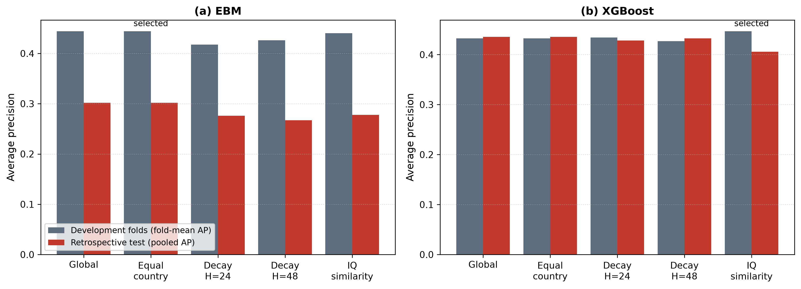

# Supplementary material

*Do institutional thresholds improve exchange-rate stress early warning? A replication-to-deployment evaluation with a pre-specified confirmation period*

**Table S1. Regime coefficients: reported versus replicated.**

| Panel | Risk | Regime | Reported (t) | Replicated | t cluster | t conv. | Classification |
|---|---|---|---|---|---|---|---|
| A | CPI_Vol | low IQ | 49.0647 (12.37) | 49.0648 | 12.38 | 21.08 | reproduced |
| A | FX_Vol | low IQ | 0.0060 (1.68) | 0.0060 | 1.22 | 1.68 | reproduced |
| A | CE_Vol | low IQ | 0.0455 (9.10) | 0.0455 | 12.34 | 9.10 | reproduced |
| A | ER_Vol | low IQ | 0.3396 (0.39) | 1.0462 | 3.97 | 4.12 | not reproduced |
| A | CG_Gap | low IQ | 0.5579 (0.94) | 0.6183 | 0.36 | 1.04 | not reproduced |
| A | Unemp | low IQ | -0.1582 (-0.88) | -0.1582 | -0.89 | -0.99 | reproduced |
| A | CPI_Vol | high IQ | -1.0075 (-3.13) | -1.0075 | -3.13 | -3.61 | reproduced |
| A | FX_Vol | high IQ | -0.1116 (-7.16) | -0.1116 | -1.96 | -7.61 | coefficient reproduced; t differs |
| A | CE_Vol | high IQ | -0.0201 (-8.15) | -0.0201 | -4.38 | -8.15 | reproduced |
| A | ER_Vol | high IQ | 0.0863 (0.25) | 0.0305 | 0.10 | 0.17 | not reproduced |
| A | CG_Gap | high IQ | -2.5950 (-4.27) | -2.6012 | -1.43 | -4.30 | coefficient reproduced; t differs |
| A | Unemp | high IQ | -6.0032 (-1.20) | -6.0032 | -2.50 | -11.65 | coefficient reproduced; t differs |
| B | CPI_Vol | low IQ | 84.6554 (2.19) | 112.8207 | 9.56 | 9.87 | not reproduced |
| B | FX_Vol | low IQ | 1.5950 (9.89) | 1.5950 | 9.90 | 9.52 | reproduced |
| B | CE_Vol | low IQ | 1.5209 (14.50) | 1.5209 | 14.51 | 16.00 | reproduced |
| B | ER_Vol | low IQ | 4.2070 (9.96) | 74.2070 | 9.96 | 11.04 | suspected transcription error (digit/sign) |
| B | CG_Gap | low IQ | 14.5626 (2.15) | 14.5626 | 2.15 | 4.20 | reproduced |
| B | Unemp | low IQ | 1.2196 (3.53) | 1.1276 | 0.50 | 0.91 | not reproduced |
| B | CPI_Vol | high IQ | 52.1320 (2.23) | -24.9266 | -1.95 | -1.90 | not reproduced |
| B | FX_Vol | high IQ | 0.0335 (1.12) | 0.0335 | 1.12 | 1.79 | reproduced |
| B | CE_Vol | high IQ | 0.0297 (1.86) | 0.0297 | 1.86 | 1.94 | reproduced |
| B | ER_Vol | high IQ | -1.1321 (2.42) | 1.1321 | 0.42 | 0.90 | suspected transcription error (digit/sign) |
| B | CG_Gap | high IQ | 3.9821 (1.26) | 33.9821 | 3.26 | 6.45 | suspected transcription error (digit/sign) |
| B | Unemp | high IQ | -7.6749 (-2.36) | -7.9710 | -3.49 | -4.30 | not reproduced |

*Note:* 'suspected transcription error': the reported value differs from the replicated one by a digit or a sign; other causes cannot be ruled out without the original code.

**Table S2. Specification search scored against the reported values.**

| Panel | Risk | Series | Other risks | Trim | N | F T(N-1) | F rep. | gamma | gamma rep. |
|---|---|---|---|---|---|---|---|---|---|
| A | CPI_Vol | cpi_vol | none | 0.01 | 678 | 590.79 | 400.68 | -0.7870 | -0.7870 |
| A | FX_Vol | fxr_vol | none | 0.01 | 678 | 103.91 | 54.62 | -0.7870 | 0.4481 |
| A | CE_Vol | consump_volnew | none | 0.01 | 678 | 180.59 | 120.64 | -0.7410 | -0.7116 |
| A | CE_Vol | consump_vol | none | 0.01 | 452 | 26.53 | 120.64 | -0.7039 | -0.7116 |
| A | ER_Vol | real_ex_vol | none | 0.01 | 678 | 50.36 | 27.24 | -0.7870 | -0.4764 |
| A | ER_Vol | ex_vol | none | 0.01 | 452 | 74.90 | 27.24 | -0.7870 | -0.4764 |
| A | CG_Gap | credit_gdp_gap | none | 0.01 | 678 | 88.26 | 83.12 | -0.3692 | -0.3692 |
| A | Unemp | unemp | none | 0.01 | 678 | 73.48 | 103.64 | 0.0240 | 0.0240 |
| A | CPI_Vol | cpi_vol | none | 0.05 | 678 | 18.39 | 400.68 | -0.7039 | -0.7870 |
| A | FX_Vol | fxr_vol | none | 0.05 | 678 | 44.97 | 54.62 | 0.5883 | 0.4481 |
| A | CE_Vol | consump_volnew | none | 0.05 | 678 | 80.48 | 120.64 | -0.7116 | -0.7116 |
| A | CE_Vol | consump_vol | none | 0.05 | 452 | 26.53 | 120.64 | -0.7039 | -0.7116 |
| A | ER_Vol | real_ex_vol | none | 0.05 | 678 | 17.04 | 27.24 | 0.2068 | -0.4764 |
| A | ER_Vol | ex_vol | none | 0.05 | 452 | 19.87 | 27.24 | 0.5320 | -0.4764 |
| A | CG_Gap | credit_gdp_gap | none | 0.05 | 678 | 88.26 | 83.12 | -0.3692 | -0.3692 |
| A | Unemp | unemp | none | 0.05 | 678 | 73.48 | 103.64 | 0.0240 | 0.0240 |
| A | CPI_Vol | cpi_vol | none | 0.15 | 678 | 2.18 | 400.68 | -0.6048 | -0.7870 |
| A | FX_Vol | fxr_vol | none | 0.15 | 678 | 44.97 | 54.62 | 0.5883 | 0.4481 |
| A | CE_Vol | consump_volnew | none | 0.15 | 678 | 27.48 | 120.64 | -0.3692 | -0.7116 |
| A | CE_Vol | consump_vol | none | 0.15 | 452 | 20.40 | 120.64 | -0.6864 | -0.7116 |
| A | ER_Vol | real_ex_vol | none | 0.15 | 678 | 17.04 | 27.24 | 0.2068 | -0.4764 |
| A | ER_Vol | ex_vol | none | 0.15 | 452 | 19.87 | 27.24 | 0.5320 | -0.4764 |
| A | CG_Gap | credit_gdp_gap | none | 0.15 | 678 | 88.26 | 83.12 | -0.3692 | -0.3692 |
| A | Unemp | unemp | none | 0.15 | 678 | 73.48 | 103.64 | 0.0240 | 0.0240 |
| A | CPI_Vol | cpi_vol | others_lag | 0.01 | 678 | 592.24 | 400.68 | -0.7870 | -0.7870 |
| A | FX_Vol | fxr_vol | others_lag | 0.01 | 678 | 140.63 | 54.62 | -0.7870 | 0.4481 |
| A | CE_Vol | consump_volnew | others_lag | 0.01 | 678 | 126.55 | 120.64 | -0.7410 | -0.7116 |
| A | CE_Vol | consump_vol | others_lag | 0.01 | 452 | 19.54 | 120.64 | -0.7039 | -0.7116 |
| A | ER_Vol | real_ex_vol | others_lag | 0.01 | 678 | 49.49 | 27.24 | -0.4764 | -0.4764 |
| A | ER_Vol | ex_vol | others_lag | 0.01 | 452 | 51.82 | 27.24 | -0.7870 | -0.4764 |
| A | CG_Gap | credit_gdp_gap | others_lag | 0.01 | 678 | 76.50 | 83.12 | -0.3692 | -0.3692 |
| A | Unemp | unemp | others_lag | 0.01 | 678 | 93.99 | 103.64 | 0.0240 | 0.0240 |
| A | CPI_Vol | cpi_vol | others_lag | 0.05 | 678 | 29.96 | 400.68 | -0.7039 | -0.7870 |
| A | FX_Vol | fxr_vol | others_lag | 0.05 | 678 | 48.40 | 54.62 | 0.5883 | 0.4481 |
| A | CE_Vol | consump_volnew | others_lag | 0.05 | 678 | 108.44 | 120.64 | -0.7116 | -0.7116 |
| A | CE_Vol | consump_vol | others_lag | 0.05 | 452 | 19.54 | 120.64 | -0.7039 | -0.7116 |
| A | ER_Vol | real_ex_vol | others_lag | 0.05 | 678 | 49.49 | 27.24 | -0.4764 | -0.4764 |
| A | ER_Vol | ex_vol | others_lag | 0.05 | 452 | 28.92 | 27.24 | 0.4644 | -0.4764 |
| A | CG_Gap | credit_gdp_gap | others_lag | 0.05 | 678 | 76.50 | 83.12 | -0.3692 | -0.3692 |
| A | Unemp | unemp | others_lag | 0.05 | 678 | 93.99 | 103.64 | 0.0240 | 0.0240 |
| A | CPI_Vol | cpi_vol | others_lag | 0.15 | 678 | 10.35 | 400.68 | 0.5320 | -0.7870 |
| A | FX_Vol | fxr_vol | others_lag | 0.15 | 678 | 48.40 | 54.62 | 0.5883 | 0.4481 |
| A | CE_Vol | consump_volnew | others_lag | 0.15 | 678 | 54.62 | 120.64 | -0.6048 | -0.7116 |
| A | CE_Vol | consump_vol | others_lag | 0.15 | 452 | 14.87 | 120.64 | -0.6864 | -0.7116 |
| A | ER_Vol | real_ex_vol | others_lag | 0.15 | 678 | 49.49 | 27.24 | -0.4764 | -0.4764 |
| A | ER_Vol | ex_vol | others_lag | 0.15 | 452 | 28.92 | 27.24 | 0.4644 | -0.4764 |
| A | CG_Gap | credit_gdp_gap | others_lag | 0.15 | 678 | 76.50 | 83.12 | -0.3692 | -0.3692 |
| A | Unemp | unemp | others_lag | 0.15 | 678 | 93.99 | 103.64 | 0.0240 | 0.0240 |
| A | CPI_Vol | cpi_vol | others_contemp | 0.01 | 678 | 400.68 | 400.68 | -0.7870 | -0.7870 |
| A | FX_Vol | fxr_vol | others_contemp | 0.01 | 678 | 54.62 | 54.62 | 0.4481 | 0.4481 |
| A | CE_Vol | consump_volnew | others_contemp | 0.01 | 678 | 120.64 | 120.64 | -0.7116 | -0.7116 |
| A | CE_Vol | consump_vol | others_contemp | 0.01 | 452 | 19.37 | 120.64 | -0.6048 | -0.7116 |
| A | ER_Vol | real_ex_vol | others_contemp | 0.01 | 678 | 27.24 | 27.24 | -0.4764 | -0.4764 |
| A | ER_Vol | ex_vol | others_contemp | 0.01 | 452 | 28.92 | 27.24 | 0.4644 | -0.4764 |
| A | CG_Gap | credit_gdp_gap | others_contemp | 0.01 | 678 | 83.12 | 83.12 | -0.3692 | -0.3692 |
| A | Unemp | unemp | others_contemp | 0.01 | 678 | 103.64 | 103.64 | 0.0240 | 0.0240 |
| A | CPI_Vol | cpi_vol | others_contemp | 0.05 | 678 | 40.28 | 400.68 | -0.7039 | -0.7870 |
| A | FX_Vol | fxr_vol | others_contemp | 0.05 | 678 | 54.62 | 54.62 | 0.4481 | 0.4481 |
| A | CE_Vol | consump_volnew | others_contemp | 0.05 | 678 | 120.64 | 120.64 | -0.7116 | -0.7116 |
| A | CE_Vol | consump_vol | others_contemp | 0.05 | 452 | 19.37 | 120.64 | -0.6048 | -0.7116 |
| A | ER_Vol | real_ex_vol | others_contemp | 0.05 | 678 | 27.24 | 27.24 | -0.4764 | -0.4764 |
| A | ER_Vol | ex_vol | others_contemp | 0.05 | 452 | 28.92 | 27.24 | 0.4644 | -0.4764 |
| A | CG_Gap | credit_gdp_gap | others_contemp | 0.05 | 678 | 83.12 | 83.12 | -0.3692 | -0.3692 |
| A | Unemp | unemp | others_contemp | 0.05 | 678 | 103.64 | 103.64 | 0.0240 | 0.0240 |
| A | CPI_Vol | cpi_vol | others_contemp | 0.15 | 678 | 8.52 | 400.68 | 0.4481 | -0.7870 |
| A | FX_Vol | fxr_vol | others_contemp | 0.15 | 678 | 54.62 | 54.62 | 0.4481 | 0.4481 |
| A | CE_Vol | consump_volnew | others_contemp | 0.15 | 678 | 68.58 | 120.64 | -0.6048 | -0.7116 |
| A | CE_Vol | consump_vol | others_contemp | 0.15 | 452 | 19.37 | 120.64 | -0.6048 | -0.7116 |
| A | ER_Vol | real_ex_vol | others_contemp | 0.15 | 678 | 27.24 | 27.24 | -0.4764 | -0.4764 |
| A | ER_Vol | ex_vol | others_contemp | 0.15 | 452 | 28.92 | 27.24 | 0.4644 | -0.4764 |
| A | CG_Gap | credit_gdp_gap | others_contemp | 0.15 | 678 | 83.12 | 83.12 | -0.3692 | -0.3692 |
| A | Unemp | unemp | others_contemp | 0.15 | 678 | 103.64 | 103.64 | 0.0240 | 0.0240 |
| B | CPI_Vol | cpi_vol | none | 0.01 | 1188 | 260.36 | 276.57 | -0.2560 | -0.2560 |
| B | FX_Vol | fxr_vol | none | 0.01 | 1188 | 92.52 | 79.31 | -0.7870 | -0.7541 |
| B | CE_Vol | consump_volnew | none | 0.01 | 1188 | 217.95 | 219.67 | -0.7116 | -0.7234 |
| B | CE_Vol | consump_vol | none | 0.01 | 792 | 8.51 | 219.67 | -0.7116 | -0.7234 |
| B | ER_Vol | real_ex_vol | none | 0.01 | 1056 | 109.13 | 104.28 | -0.7039 | -0.7039 |
| B | ER_Vol | ex_vol | none | 0.01 | 918 | 184.26 | 104.28 | 0.9542 | -0.7039 |
| B | CG_Gap | credit_gdp_gap | none | 0.01 | 1188 | 57.86 | 34.61 | -0.1554 | -0.1554 |
| B | Unemp | unemp | none | 0.01 | 1188 | 48.22 | 54.34 | -0.1416 | -0.1416 |
| B | CPI_Vol | cpi_vol | none | 0.05 | 1188 | 260.36 | 276.57 | -0.2560 | -0.2560 |
| B | FX_Vol | fxr_vol | none | 0.05 | 1188 | 28.23 | 79.31 | -0.3149 | -0.7541 |
| B | CE_Vol | consump_volnew | none | 0.05 | 1188 | 217.95 | 219.67 | -0.7116 | -0.7234 |
| B | CE_Vol | consump_vol | none | 0.05 | 792 | 8.51 | 219.67 | -0.7116 | -0.7234 |
| B | ER_Vol | real_ex_vol | none | 0.05 | 1056 | 109.13 | 104.28 | -0.7039 | -0.7039 |
| B | ER_Vol | ex_vol | none | 0.05 | 918 | 41.47 | 104.28 | 0.9436 | -0.7039 |
| B | CG_Gap | credit_gdp_gap | none | 0.05 | 1188 | 57.86 | 34.61 | -0.1554 | -0.1554 |
| B | Unemp | unemp | none | 0.05 | 1188 | 48.22 | 54.34 | -0.1416 | -0.1416 |
| B | CPI_Vol | cpi_vol | none | 0.15 | 1188 | 260.36 | 276.57 | -0.2560 | -0.2560 |
| B | FX_Vol | fxr_vol | none | 0.15 | 1188 | 28.23 | 79.31 | -0.3149 | -0.7541 |
| B | CE_Vol | consump_volnew | none | 0.15 | 1188 | 48.69 | 219.67 | -0.2660 | -0.7234 |
| B | CE_Vol | consump_vol | none | 0.15 | 792 | 6.44 | 219.67 | -0.2504 | -0.7234 |
| B | ER_Vol | real_ex_vol | none | 0.15 | 1056 | 27.43 | 104.28 | -0.2560 | -0.7039 |
| B | ER_Vol | ex_vol | none | 0.15 | 918 | 12.71 | 104.28 | 0.4821 | -0.7039 |
| B | CG_Gap | credit_gdp_gap | none | 0.15 | 1188 | 57.86 | 34.61 | -0.1554 | -0.1554 |
| B | Unemp | unemp | none | 0.15 | 1188 | 48.22 | 54.34 | -0.1416 | -0.1416 |
| B | CPI_Vol | cpi_vol | others_lag | 0.01 | 1188 | 262.53 | 276.57 | -0.2560 | -0.2560 |
| B | FX_Vol | fxr_vol | others_lag | 0.01 | 1188 | 88.96 | 79.31 | -0.7870 | -0.7541 |
| B | CE_Vol | consump_volnew | others_lag | 0.01 | 1188 | 213.17 | 219.67 | -0.7116 | -0.7234 |
| B | CE_Vol | consump_vol | others_lag | 0.01 | 792 | 10.29 | 219.67 | -0.7116 | -0.7234 |
| B | ER_Vol | real_ex_vol | others_lag | 0.01 | 1056 | 112.27 | 104.28 | -0.7039 | -0.7039 |
| B | ER_Vol | ex_vol | others_lag | 0.01 | 918 | 137.32 | 104.28 | 0.9542 | -0.7039 |
| B | CG_Gap | credit_gdp_gap | others_lag | 0.01 | 1188 | 24.50 | 34.61 | -0.1554 | -0.1554 |
| B | Unemp | unemp | others_lag | 0.01 | 1188 | 70.85 | 54.34 | -0.1416 | -0.1416 |
| B | CPI_Vol | cpi_vol | others_lag | 0.05 | 1188 | 262.53 | 276.57 | -0.2560 | -0.2560 |
| B | FX_Vol | fxr_vol | others_lag | 0.05 | 1188 | 35.38 | 79.31 | -0.3149 | -0.7541 |
| B | CE_Vol | consump_volnew | others_lag | 0.05 | 1188 | 213.17 | 219.67 | -0.7116 | -0.7234 |
| B | CE_Vol | consump_vol | others_lag | 0.05 | 792 | 10.29 | 219.67 | -0.7116 | -0.7234 |
| B | ER_Vol | real_ex_vol | others_lag | 0.05 | 1056 | 112.27 | 104.28 | -0.7039 | -0.7039 |
| B | ER_Vol | ex_vol | others_lag | 0.05 | 918 | 19.35 | 104.28 | 0.9436 | -0.7039 |
| B | CG_Gap | credit_gdp_gap | others_lag | 0.05 | 1188 | 24.50 | 34.61 | -0.1554 | -0.1554 |
| B | Unemp | unemp | others_lag | 0.05 | 1188 | 70.85 | 54.34 | -0.1416 | -0.1416 |
| B | CPI_Vol | cpi_vol | others_lag | 0.15 | 1188 | 262.53 | 276.57 | -0.2560 | -0.2560 |
| B | FX_Vol | fxr_vol | others_lag | 0.15 | 1188 | 35.38 | 79.31 | -0.3149 | -0.7541 |
| B | CE_Vol | consump_volnew | others_lag | 0.15 | 1188 | 60.97 | 219.67 | -0.0377 | -0.7234 |
| B | CE_Vol | consump_vol | others_lag | 0.15 | 792 | 6.86 | 219.67 | -0.2684 | -0.7234 |
| B | ER_Vol | real_ex_vol | others_lag | 0.15 | 1056 | 26.86 | 104.28 | -0.4764 | -0.7039 |
| B | ER_Vol | ex_vol | others_lag | 0.15 | 918 | 11.67 | 104.28 | -0.2098 | -0.7039 |
| B | CG_Gap | credit_gdp_gap | others_lag | 0.15 | 1188 | 24.50 | 34.61 | -0.1554 | -0.1554 |
| B | Unemp | unemp | others_lag | 0.15 | 1188 | 70.85 | 54.34 | -0.1416 | -0.1416 |
| B | CPI_Vol | cpi_vol | others_contemp | 0.01 | 1188 | 276.57 | 276.57 | -0.2560 | -0.2560 |
| B | FX_Vol | fxr_vol | others_contemp | 0.01 | 1188 | 79.31 | 79.31 | -0.7870 | -0.7541 |
| B | CE_Vol | consump_volnew | others_contemp | 0.01 | 1188 | 219.67 | 219.67 | -0.7116 | -0.7234 |
| B | CE_Vol | consump_vol | others_contemp | 0.01 | 792 | 9.87 | 219.67 | -0.2504 | -0.7234 |
| B | ER_Vol | real_ex_vol | others_contemp | 0.01 | 1056 | 104.28 | 104.28 | -0.7039 | -0.7039 |
| B | ER_Vol | ex_vol | others_contemp | 0.01 | 918 | 147.20 | 104.28 | 0.9542 | -0.7039 |
| B | CG_Gap | credit_gdp_gap | others_contemp | 0.01 | 1188 | 34.61 | 34.61 | -0.1554 | -0.1554 |
| B | Unemp | unemp | others_contemp | 0.01 | 1188 | 54.34 | 54.34 | -0.1416 | -0.1416 |
| B | CPI_Vol | cpi_vol | others_contemp | 0.05 | 1188 | 276.57 | 276.57 | -0.2560 | -0.2560 |
| B | FX_Vol | fxr_vol | others_contemp | 0.05 | 1188 | 38.39 | 79.31 | -0.3034 | -0.7541 |
| B | CE_Vol | consump_volnew | others_contemp | 0.05 | 1188 | 219.67 | 219.67 | -0.7116 | -0.7234 |
| B | CE_Vol | consump_vol | others_contemp | 0.05 | 792 | 9.87 | 219.67 | -0.2504 | -0.7234 |
| B | ER_Vol | real_ex_vol | others_contemp | 0.05 | 1056 | 104.28 | 104.28 | -0.7039 | -0.7039 |
| B | ER_Vol | ex_vol | others_contemp | 0.05 | 918 | 21.83 | 104.28 | 0.9436 | -0.7039 |
| B | CG_Gap | credit_gdp_gap | others_contemp | 0.05 | 1188 | 34.61 | 34.61 | -0.1554 | -0.1554 |
| B | Unemp | unemp | others_contemp | 0.05 | 1188 | 54.34 | 54.34 | -0.1416 | -0.1416 |
| B | CPI_Vol | cpi_vol | others_contemp | 0.15 | 1188 | 276.57 | 276.57 | -0.2560 | -0.2560 |
| B | FX_Vol | fxr_vol | others_contemp | 0.15 | 1188 | 38.39 | 79.31 | -0.3034 | -0.7541 |
| B | CE_Vol | consump_volnew | others_contemp | 0.15 | 1188 | 66.46 | 219.67 | -0.2560 | -0.7234 |
| B | CE_Vol | consump_vol | others_contemp | 0.15 | 792 | 9.87 | 219.67 | -0.2504 | -0.7234 |
| B | ER_Vol | real_ex_vol | others_contemp | 0.15 | 1056 | 22.40 | 104.28 | -0.4764 | -0.7039 |
| B | ER_Vol | ex_vol | others_contemp | 0.15 | 918 | 9.84 | 104.28 | -0.1230 | -0.7039 |
| B | CG_Gap | credit_gdp_gap | others_contemp | 0.15 | 1188 | 34.61 | 34.61 | -0.1554 | -0.1554 |
| B | Unemp | unemp | others_contemp | 0.15 | 1188 | 54.34 | 54.34 | -0.1416 | -0.1416 |

**Table S3. Threshold tests by trimming fraction.**

| Panel | Risk | Trim | N | F Hansen | p | Threshold | Low regime % |
|---|---|---|---|---|---|---|---|
| A | CPI_Vol | 0.01 | 678 | 476.56 | 0.0005 | -0.7870 | 1.8 |
| A | FX_Vol | 0.01 | 678 | 64.97 | 0.0195 | 0.4481 | 68.4 |
| A | CE_Vol | 0.01 | 678 | 143.49 | 0.0180 | -0.7116 | 7.8 |
| A | ER_Vol | 0.01 | 678 | 32.40 | 0.8885 | -0.4764 | 22.7 |
| A | CG_Gap | 0.01 | 678 | 98.86 | 0.0375 | -0.3692 | 33.3 |
| A | Unemp | 0.01 | 678 | 123.27 | 0.0005 | 0.0240 | 51.8 |
| A | CPI_Vol | 0.05 | 678 | 47.91 | 0.2985 | -0.7039 | 9.6 |
| A | FX_Vol | 0.05 | 678 | 64.97 | 0.0175 | 0.4481 | 68.4 |
| A | CE_Vol | 0.05 | 678 | 143.49 | 0.0180 | -0.7116 | 7.8 |
| A | ER_Vol | 0.05 | 678 | 32.40 | 0.8550 | -0.4764 | 22.7 |
| A | CG_Gap | 0.05 | 678 | 98.86 | 0.0375 | -0.3692 | 33.3 |
| A | Unemp | 0.05 | 678 | 123.27 | 0.0005 | 0.0240 | 51.8 |
| A | CPI_Vol | 0.10 | 678 | 22.15 | 0.6720 | -0.6864 | 11.4 |
| A | FX_Vol | 0.10 | 678 | 64.97 | 0.0175 | 0.4481 | 68.4 |
| A | CE_Vol | 0.10 | 678 | 88.33 | 0.1235 | -0.6665 | 13.1 |
| A | ER_Vol | 0.10 | 678 | 32.40 | 0.8375 | -0.4764 | 22.7 |
| A | CG_Gap | 0.10 | 678 | 98.86 | 0.0335 | -0.3692 | 33.3 |
| A | Unemp | 0.10 | 678 | 123.27 | 0.0005 | 0.0240 | 51.8 |
| A | CPI_Vol | 0.15 | 678 | 10.13 | 0.8910 | 0.4481 | 68.4 |
| A | FX_Vol | 0.15 | 678 | 64.97 | 0.0175 | 0.4481 | 68.4 |
| A | CE_Vol | 0.15 | 678 | 81.56 | 0.1650 | -0.6048 | 16.7 |
| A | ER_Vol | 0.15 | 678 | 32.40 | 0.8085 | -0.4764 | 22.7 |
| A | CG_Gap | 0.15 | 678 | 98.86 | 0.0300 | -0.3692 | 33.3 |
| A | Unemp | 0.15 | 678 | 123.27 | 0.0005 | 0.0240 | 51.8 |
| B | CPI_Vol | 0.01 | 1188 | 308.79 | 0.0450 | -0.2560 | 35.4 |
| B | FX_Vol | 0.01 | 1188 | 88.55 | 0.0295 | -0.7870 | 1.0 |
| B | CE_Vol | 0.01 | 1188 | 245.25 | 0.0005 | -0.7116 | 5.1 |
| B | ER_Vol | 0.01 | 1056 | 118.28 | 0.0605 | -0.7039 | 8.0 |
| B | CG_Gap | 0.01 | 1188 | 38.64 | 0.6500 | -0.1554 | 44.4 |
| B | Unemp | 0.01 | 1188 | 60.67 | 0.1325 | -0.1416 | 46.5 |
| B | CPI_Vol | 0.05 | 1188 | 308.79 | 0.0450 | -0.2560 | 35.4 |
| B | FX_Vol | 0.05 | 1188 | 42.86 | 0.1985 | -0.3034 | 28.3 |
| B | CE_Vol | 0.05 | 1188 | 245.25 | 0.0005 | -0.7116 | 5.1 |
| B | ER_Vol | 0.05 | 1056 | 118.28 | 0.0605 | -0.7039 | 8.0 |
| B | CG_Gap | 0.05 | 1188 | 38.64 | 0.6080 | -0.1554 | 44.4 |
| B | Unemp | 0.05 | 1188 | 60.67 | 0.0815 | -0.1416 | 46.5 |
| B | CPI_Vol | 0.10 | 1188 | 308.79 | 0.0030 | -0.2560 | 35.4 |
| B | FX_Vol | 0.10 | 1188 | 42.86 | 0.1740 | -0.3034 | 28.3 |
| B | CE_Vol | 0.10 | 1188 | 74.20 | 0.2210 | -0.2560 | 35.4 |
| B | ER_Vol | 0.10 | 1056 | 57.98 | 0.3895 | -0.6665 | 10.2 |
| B | CG_Gap | 0.10 | 1188 | 38.64 | 0.5575 | -0.1554 | 44.4 |
| B | Unemp | 0.10 | 1188 | 60.67 | 0.0740 | -0.1416 | 46.5 |
| B | CPI_Vol | 0.15 | 1188 | 308.79 | 0.0030 | -0.2560 | 35.4 |
| B | FX_Vol | 0.15 | 1188 | 42.86 | 0.1390 | -0.3034 | 28.3 |
| B | CE_Vol | 0.15 | 1188 | 74.20 | 0.1595 | -0.2560 | 35.4 |
| B | ER_Vol | 0.15 | 1056 | 25.41 | 0.7235 | -0.4764 | 18.2 |
| B | CG_Gap | 0.15 | 1188 | 38.64 | 0.4705 | -0.1554 | 44.4 |
| B | Unemp | 0.15 | 1188 | 60.67 | 0.0630 | -0.1416 | 46.5 |

**Table S4. Pseudo-real-time threshold regressions.**

| Panel | Risk | N | F Hansen | p | Threshold | b low IQ | t cl. | b high IQ | t cl. |
|---|---|---|---|---|---|---|---|---|---|
| A | CPI_Vol | 600 | 46.71 | 0.6190 | -0.7410 | -8.9146 | -4.13 | 0.2585 | 0.41 |
| A | FX_Vol | 600 | 44.71 | 0.3830 | 0.0318 | 0.0013 | 0.50 | -0.0913 | -4.94 |
| A | CE_Vol | 600 | 61.67 | 0.0720 | -0.4452 | -0.0073 | -1.84 | 0.0058 | 0.82 |
| A | ER_Vol | 600 | 93.94 | 0.0600 | -0.1701 | -0.0208 | -0.09 | -6.8675 | -3.82 |
| A | CG_Gap | 600 | 93.89 | 0.0125 | -0.4764 | 0.9586 | 0.64 | -3.1485 | -1.68 |
| A | Unemp | 600 | 33.83 | 0.6380 | 0.0781 | -0.0672 | -0.22 | -2.8932 | -5.29 |
| B | CPI_Vol | 1008 | 222.68 | 0.0310 | -0.2504 | 28.9234 | 2.07 | 170.0701 | 5.21 |
| B | FX_Vol | 1008 | 82.31 | 0.0135 | -0.7346 | 1.3795 | 7.34 | 0.0242 | 0.58 |
| B | CE_Vol | 1008 | 273.66 | 0.0005 | -0.7116 | 1.7534 | 10.60 | -0.0036 | -0.21 |
| B | ER_Vol | 896 | 47.15 | 0.5365 | -0.7410 | -67.9180 | -4.96 | 4.4315 | 4.90 |
| B | CG_Gap | 1008 | 29.28 | 0.7400 | -0.3274 | -53.0671 | -1.43 | 11.4758 | 2.22 |
| B | Unemp | 1008 | 40.37 | 0.4970 | -0.0377 | -4.1262 | -0.98 | -15.8506 | -2.24 |

*Note:* CI lagged one month; IQ and annual controls from their September release.

**Table S5. Threshold tests with single WGI dimensions.**

| Panel | WGI dimension | Risk | N | F | p | Threshold |
|---|---|---|---|---|---|---|
| A | Voice and Accountability | CPI_Vol | 678 | 9.98 | 0.9740 | -1.0898 |
| A | Voice and Accountability | FX_Vol | 678 | 39.80 | 0.1945 | 0.6181 |
| A | Voice and Accountability | CE_Vol | 678 | 103.58 | 0.0405 | -1.0745 |
| A | Voice and Accountability | ER_Vol | 678 | 105.42 | 0.0620 | -0.0675 |
| A | Voice and Accountability | CG_Gap | 678 | 112.69 | 0.0775 | -1.6473 |
| A | Voice and Accountability | Unemp | 678 | 11.49 | 0.8560 | -1.6167 |
| A | Political Stability No Violence | CPI_Vol | 678 | 476.56 | 0.0005 | -1.0293 |
| A | Political Stability No Violence | FX_Vol | 678 | 54.18 | 0.2300 | 0.7472 |
| A | Political Stability No Violence | CE_Vol | 678 | 113.14 | 0.0200 | -0.6625 |
| A | Political Stability No Violence | ER_Vol | 678 | 41.04 | 0.7450 | -0.7974 |
| A | Political Stability No Violence | CG_Gap | 678 | 82.98 | 0.1115 | -0.4994 |
| A | Political Stability No Violence | Unemp | 678 | 40.26 | 0.1885 | -0.5574 |
| A | Government Effectiveness | CPI_Vol | 678 | 53.14 | 0.0380 | -0.1761 |
| A | Government Effectiveness | FX_Vol | 678 | 21.52 | 0.4990 | -0.2427 |
| A | Government Effectiveness | CE_Vol | 678 | 81.77 | 0.1265 | -0.1876 |
| A | Government Effectiveness | ER_Vol | 678 | 78.26 | 0.3240 | -0.2427 |
| A | Government Effectiveness | CG_Gap | 678 | 74.04 | 0.1185 | 0.4378 |
| A | Government Effectiveness | Unemp | 678 | 21.33 | 0.5285 | 0.0653 |
| A | Regulatory Quality | CPI_Vol | 678 | 476.56 | 0.0005 | -0.5600 |
| A | Regulatory Quality | FX_Vol | 678 | 40.37 | 0.2115 | 0.5997 |
| A | Regulatory Quality | CE_Vol | 678 | 88.54 | 0.1600 | -0.4641 |
| A | Regulatory Quality | ER_Vol | 678 | 135.89 | 0.0640 | 0.1529 |
| A | Regulatory Quality | CG_Gap | 678 | 72.73 | 0.2230 | -0.4327 |
| A | Regulatory Quality | Unemp | 678 | 43.09 | 0.1010 | -0.0731 |
| A | Rule of Law | CPI_Vol | 678 | 65.99 | 0.1910 | -0.8698 |
| A | Rule of Law | FX_Vol | 678 | 27.95 | 0.6070 | -0.8698 |
| A | Rule of Law | CE_Vol | 678 | 76.03 | 0.0655 | -0.4350 |
| A | Rule of Law | ER_Vol | 678 | 83.53 | 0.3620 | -0.6264 |
| A | Rule of Law | CG_Gap | 678 | 90.21 | 0.1360 | -0.3092 |
| A | Rule of Law | Unemp | 678 | 32.01 | 0.3745 | 0.0638 |
| A | Control of Corruption | CPI_Vol | 678 | 52.77 | 0.0620 | -0.8992 |
| A | Control of Corruption | FX_Vol | 678 | 33.80 | 0.5040 | 0.5720 |
| A | Control of Corruption | CE_Vol | 678 | 85.10 | 0.1015 | -0.4845 |
| A | Control of Corruption | ER_Vol | 678 | 35.09 | 0.7785 | -0.3374 |
| A | Control of Corruption | CG_Gap | 678 | 106.44 | 0.0355 | -0.9021 |
| A | Control of Corruption | Unemp | 678 | 14.50 | 0.7270 | 0.6598 |
| B | Voice and Accountability | CPI_Vol | 1188 | 401.88 | 0.0430 | 0.2782 |
| B | Voice and Accountability | FX_Vol | 1188 | 25.91 | 0.5750 | -1.0898 |
| B | Voice and Accountability | CE_Vol | 1188 | 47.66 | 0.5225 | 0.7058 |
| B | Voice and Accountability | ER_Vol | 1056 | 36.06 | 0.6700 | 0.7058 |
| B | Voice and Accountability | CG_Gap | 1188 | 85.14 | 0.2060 | -1.0898 |
| B | Voice and Accountability | Unemp | 1188 | 47.21 | 0.3505 | 0.1127 |
| B | Political Stability No Violence | CPI_Vol | 1188 | 137.01 | 0.1290 | -0.4850 |
| B | Political Stability No Violence | FX_Vol | 1188 | 73.81 | 0.0210 | 0.7472 |
| B | Political Stability No Violence | CE_Vol | 1188 | 72.40 | 0.2110 | -0.9436 |
| B | Political Stability No Violence | ER_Vol | 1056 | 55.46 | 0.4485 | -0.7974 |
| B | Political Stability No Violence | CG_Gap | 1188 | 76.90 | 0.3200 | -0.9462 |
| B | Political Stability No Violence | Unemp | 1188 | 56.14 | 0.2270 | -0.3294 |
| B | Government Effectiveness | CPI_Vol | 1188 | 344.59 | 0.0005 | -0.4603 |
| B | Government Effectiveness | FX_Vol | 1188 | 19.20 | 0.5465 | 0.2954 |
| B | Government Effectiveness | CE_Vol | 1188 | 84.56 | 0.0360 | -0.1692 |
| B | Government Effectiveness | ER_Vol | 1056 | 91.60 | 0.0815 | 1.0398 |
| B | Government Effectiveness | CG_Gap | 1188 | 29.11 | 0.8665 | 0.3075 |
| B | Government Effectiveness | Unemp | 1188 | 87.56 | 0.0225 | 0.2954 |
| B | Regulatory Quality | CPI_Vol | 1188 | 242.61 | 0.0060 | -0.1108 |
| B | Regulatory Quality | FX_Vol | 1188 | 88.55 | 0.0330 | -0.5600 |
| B | Regulatory Quality | CE_Vol | 1188 | 85.28 | 0.0835 | -0.5600 |
| B | Regulatory Quality | ER_Vol | 1056 | 68.86 | 0.2020 | 1.1109 |
| B | Regulatory Quality | CG_Gap | 1188 | 60.90 | 0.4090 | -0.2888 |
| B | Regulatory Quality | Unemp | 1188 | 101.98 | 0.0105 | -0.0972 |
| B | Rule of Law | CPI_Vol | 1188 | 189.52 | 0.1795 | -0.2873 |
| B | Rule of Law | FX_Vol | 1188 | 109.00 | 0.0055 | -0.7997 |
| B | Rule of Law | CE_Vol | 1188 | 60.84 | 0.2860 | -0.4350 |
| B | Rule of Law | ER_Vol | 1056 | 80.25 | 0.0860 | -0.8698 |
| B | Rule of Law | CG_Gap | 1188 | 67.90 | 0.2285 | -0.7997 |
| B | Rule of Law | Unemp | 1188 | 64.41 | 0.2410 | -0.0379 |
| B | Control of Corruption | CPI_Vol | 1188 | 247.17 | 0.0550 | -0.4223 |
| B | Control of Corruption | FX_Vol | 1188 | 30.32 | 0.4830 | -0.9522 |
| B | Control of Corruption | CE_Vol | 1188 | 83.18 | 0.0895 | -0.9522 |
| B | Control of Corruption | ER_Vol | 1056 | 51.96 | 0.4305 | -0.8176 |
| B | Control of Corruption | CG_Gap | 1188 | 115.60 | 0.0815 | -0.9021 |
| B | Control of Corruption | Unemp | 1188 | 63.40 | 0.1480 | -0.3862 |

**Table S6. Robustness matrix.**

| Window | Specification | Model | N | Pos. | AP pooled | AP fold mean | Brier | Cost |
|---|---|---|---|---|---|---|---|---|
| all | Main (q80 pooled, h=3, CI lag 1, REER t-1) | B0 Persistence | 648 | 121 | 0.440 | 0.377 | 0.133 | 53.4 |
| all | Main (q80 pooled, h=3, CI lag 1, REER t-1) | B1 Ridge / logistic | 648 | 121 | 0.372 | 0.398 | 0.152 | 43.1 |
| all | Main (q80 pooled, h=3, CI lag 1, REER t-1) | B4 XGBoost | 648 | 121 | 0.460 | 0.416 | 0.124 | 43.8 |
| all | Main (q80 pooled, h=3, CI lag 1, REER t-1) | M0 EBM additive | 648 | 121 | 0.386 | 0.406 | 0.132 | 43.7 |
| all | Main (q80 pooled, h=3, CI lag 1, REER t-1) | M1 EBM + CI x IQ | 648 | 121 | 0.381 | 0.400 | 0.133 | 43.4 |
| all | Threshold q75 (pooled) | B0 Persistence | 648 | 167 | 0.541 | 0.509 | 0.161 | 62.0 |
| all | Threshold q75 (pooled) | B1 Ridge / logistic | 648 | 167 | 0.514 | 0.535 | 0.159 | 41.7 |
| all | Threshold q75 (pooled) | B4 XGBoost | 648 | 167 | 0.583 | 0.563 | 0.146 | 45.5 |
| all | Threshold q75 (pooled) | M0 EBM additive | 648 | 167 | 0.525 | 0.541 | 0.148 | 39.4 |
| all | Threshold q75 (pooled) | M1 EBM + CI x IQ | 648 | 167 | 0.538 | 0.555 | 0.146 | 38.9 |
| all | Threshold q90 (pooled) | B0 Persistence | 648 | 70 | 0.182 | 0.210 | 0.097 | 51.7 |
| all | Threshold q90 (pooled) | B1 Ridge / logistic | 648 | 70 | 0.246 | 0.293 | 0.097 | 49.7 |
| all | Threshold q90 (pooled) | B4 XGBoost | 648 | 70 | 0.244 | 0.307 | 0.092 | 48.1 |
| all | Threshold q90 (pooled) | M0 EBM additive | 648 | 70 | 0.292 | 0.309 | 0.088 | 45.2 |
| all | Threshold q90 (pooled) | M1 EBM + CI x IQ | 648 | 70 | 0.287 | 0.281 | 0.089 | 46.5 |
| all | Threshold q80 (country-specific) | B0 Persistence | 648 | 156 | 0.248 | 0.241 | 0.191 | 87.2 |
| all | Threshold q80 (country-specific) | B1 Ridge / logistic | 648 | 156 | 0.349 | 0.340 | 0.185 | 82.4 |
| all | Threshold q80 (country-specific) | B4 XGBoost | 648 | 156 | 0.406 | 0.296 | 0.177 | 80.7 |
| all | Threshold q80 (country-specific) | M0 EBM additive | 648 | 156 | 0.388 | 0.322 | 0.177 | 86.6 |
| all | Threshold q80 (country-specific) | M1 EBM + CI x IQ | 648 | 156 | 0.394 | 0.331 | 0.176 | 86.1 |
| all | Horizon h=6 | B0 Persistence | 648 | 140 | 0.493 | 0.472 | 0.145 | 56.9 |
| all | Horizon h=6 | B1 Ridge / logistic | 648 | 140 | 0.436 | 0.465 | 0.154 | 46.9 |
| all | Horizon h=6 | B4 XGBoost | 648 | 140 | 0.413 | 0.474 | 0.154 | 47.5 |
| all | Horizon h=6 | M0 EBM additive | 648 | 140 | 0.371 | 0.458 | 0.162 | 45.7 |
| all | Horizon h=6 | M1 EBM + CI x IQ | 648 | 140 | 0.378 | 0.458 | 0.161 | 47.8 |
| all | Reserve drawdown target (h=3) | B0 Persistence | 648 | 117 | 0.198 | 0.276 | 0.153 | 88.0 |
| all | Reserve drawdown target (h=3) | B1 Ridge / logistic | 648 | 117 | 0.291 | 0.300 | 0.150 | 77.2 |
| all | Reserve drawdown target (h=3) | B2 Threshold model | 648 | 117 | 0.276 | 0.322 | 0.155 | 73.0 |
| all | Reserve drawdown target (h=3) | B4 XGBoost | 648 | 117 | 0.250 | 0.302 | 0.152 | 76.7 |
| all | Reserve drawdown target (h=3) | M0 EBM additive | 648 | 117 | 0.227 | 0.295 | 0.151 | 78.4 |
| all | Reserve drawdown target (h=3) | M1 EBM + CI x IQ | 648 | 117 | 0.232 | 0.288 | 0.151 | 76.1 |
| all | WGI dimension PV in M1 | M1 EBM + CI x IQ | 648 | 121 | 0.391 | 0.406 | 0.132 | 45.7 |
| all | WGI dimension RQ in M1 | M1 EBM + CI x IQ | 648 | 121 | 0.377 | 0.404 | 0.134 | 42.6 |
| all | WGI dimension GE in M1 | M1 EBM + CI x IQ | 648 | 121 | 0.377 | 0.401 | 0.134 | 42.4 |
| all | WGI dimension RL in M1 | M1 EBM + CI x IQ | 648 | 121 | 0.366 | 0.375 | 0.135 | 43.7 |
| all | WGI dimension CC in M1 | M1 EBM + CI x IQ | 648 | 121 | 0.370 | 0.386 | 0.135 | 42.7 |
| all | WGI dimension VA in M1 | M1 EBM + CI x IQ | 648 | 121 | 0.353 | 0.381 | 0.138 | 43.8 |
| all | Core-6 matched: SWIFT share | B0 Persistence | 432 | 84 | 0.379 | 0.352 | 0.145 | 71.5 |
| all | Core-6 matched: SWIFT share | B1 Ridge / logistic | 432 | 84 | 0.333 | 0.401 | 0.190 | 50.7 |
| all | Core-6 matched: SWIFT share | M0 EBM additive | 432 | 84 | 0.428 | 0.471 | 0.132 | 42.1 |
| all | Core-6 matched: SWIFT share | M1 EBM + CI x IQ | 432 | 84 | 0.430 | 0.477 | 0.132 | 44.7 |
| all | Core-6 matched: FX share | B0 Persistence | 432 | 84 | 0.379 | 0.352 | 0.145 | 71.5 |
| all | Core-6 matched: FX share | B1 Ridge / logistic | 432 | 84 | 0.322 | 0.385 | 0.175 | 48.1 |
| all | Core-6 matched: FX share | M0 EBM additive | 432 | 84 | 0.372 | 0.420 | 0.145 | 52.5 |
| all | Core-6 matched: FX share | M1 EBM + CI x IQ | 432 | 84 | 0.351 | 0.405 | 0.146 | 53.9 |
| all | Core-6 matched: both CI | B0 Persistence | 432 | 84 | 0.379 | 0.352 | 0.145 | 71.5 |
| all | Core-6 matched: both CI | B1 Ridge / logistic | 432 | 84 | 0.340 | 0.393 | 0.175 | 48.4 |
| all | Core-6 matched: both CI | M0 EBM additive | 432 | 84 | 0.412 | 0.477 | 0.138 | 47.7 |
| all | Core-6 matched: both CI | M1 EBM + CI x IQ | 432 | 84 | 0.425 | 0.472 | 0.136 | 49.5 |
| all | Core-6 matched: no CI | B0 Persistence | 432 | 84 | 0.379 | 0.352 | 0.145 | 71.5 |
| all | Core-6 matched: no CI | B1 Ridge / logistic | 432 | 84 | 0.321 | 0.385 | 0.190 | 50.9 |
| all | Core-6 matched: no CI | M0 EBM additive | 432 | 84 | 0.394 | 0.459 | 0.139 | 51.6 |
| all | Core-6 matched: no CI | M1 EBM + CI x IQ | 432 | 84 | 0.394 | 0.459 | 0.139 | 51.6 |
| all | Timing: month-t REER in features (not real-time) | B0 Persistence | 648 | 121 | 0.481 | 0.397 | 0.129 | 50.8 |
| all | Timing: month-t REER in features (not real-time) | B1 Ridge / logistic | 648 | 121 | 0.372 | 0.400 | 0.148 | 40.4 |
| all | Timing: month-t REER in features (not real-time) | B4 XGBoost | 648 | 121 | 0.455 | 0.425 | 0.124 | 44.0 |
| all | Timing: month-t REER in features (not real-time) | M0 EBM additive | 648 | 121 | 0.468 | 0.457 | 0.124 | 42.9 |
| all | Timing: month-t REER in features (not real-time) | M1 EBM + CI x IQ | 648 | 121 | 0.474 | 0.465 | 0.124 | 42.3 |
| all | Timing: CI release lag 3 months | M0 EBM additive | 648 | 121 | 0.412 | 0.426 | 0.127 | 40.3 |
| all | Timing: CI release lag 3 months | M1 EBM + CI x IQ | 648 | 121 | 0.415 | 0.422 | 0.127 | 40.9 |
| all | Timing: CI release lag 6 months | M0 EBM additive | 648 | 121 | 0.404 | 0.414 | 0.128 | 40.9 |
| all | Timing: CI release lag 6 months | M1 EBM + CI x IQ | 648 | 121 | 0.395 | 0.405 | 0.129 | 41.2 |
| all | Timing: CI release lag 12 months | M0 EBM additive | 648 | 121 | 0.405 | 0.424 | 0.129 | 41.8 |
| all | Timing: CI release lag 12 months | M1 EBM + CI x IQ | 648 | 121 | 0.403 | 0.417 | 0.129 | 41.0 |
| all | Timing: CI frozen at training cut-off | M0 EBM additive | 648 | 121 | 0.381 | 0.396 | 0.132 | 41.2 |
| all | Timing: CI frozen at training cut-off | M1 EBM + CI x IQ | 648 | 121 | 0.376 | 0.389 | 0.133 | 41.7 |
| retro | Main (q80 pooled, h=3, CI lag 1, REER t-1) | B0 Persistence | 216 | 36 | 0.535 | 0.475 | 0.111 | 41.2 |
| retro | Main (q80 pooled, h=3, CI lag 1, REER t-1) | B1 Ridge / logistic | 216 | 36 | 0.349 | 0.349 | 0.194 | 54.2 |
| retro | Main (q80 pooled, h=3, CI lag 1, REER t-1) | B4 XGBoost | 216 | 36 | 0.424 | 0.375 | 0.121 | 52.8 |
| retro | Main (q80 pooled, h=3, CI lag 1, REER t-1) | M0 EBM additive | 216 | 36 | 0.306 | 0.354 | 0.148 | 66.7 |
| retro | Main (q80 pooled, h=3, CI lag 1, REER t-1) | M1 EBM + CI x IQ | 216 | 36 | 0.307 | 0.358 | 0.148 | 66.7 |
| retro | Threshold q75 (pooled) | B0 Persistence | 216 | 58 | 0.615 | 0.641 | 0.159 | 47.7 |
| retro | Threshold q75 (pooled) | B1 Ridge / logistic | 216 | 58 | 0.483 | 0.529 | 0.212 | 61.6 |
| retro | Threshold q75 (pooled) | B4 XGBoost | 216 | 58 | 0.565 | 0.609 | 0.161 | 60.6 |
| retro | Threshold q75 (pooled) | M0 EBM additive | 216 | 58 | 0.496 | 0.513 | 0.172 | 53.2 |
| retro | Threshold q75 (pooled) | M1 EBM + CI x IQ | 216 | 58 | 0.498 | 0.514 | 0.171 | 51.4 |
| retro | Threshold q90 (pooled) | B0 Persistence | 216 | 23 | 0.322 | 0.297 | 0.094 | 45.4 |
| retro | Threshold q90 (pooled) | B1 Ridge / logistic | 216 | 23 | 0.350 | 0.394 | 0.094 | 43.5 |
| retro | Threshold q90 (pooled) | B4 XGBoost | 216 | 23 | 0.377 | 0.399 | 0.086 | 47.7 |
| retro | Threshold q90 (pooled) | M0 EBM additive | 216 | 23 | 0.350 | 0.418 | 0.083 | 35.6 |
| retro | Threshold q90 (pooled) | M1 EBM + CI x IQ | 216 | 23 | 0.340 | 0.349 | 0.084 | 37.0 |
| retro | Threshold q80 (country-specific) | B0 Persistence | 216 | 75 | 0.394 | 0.364 | 0.252 | 75.0 |
| retro | Threshold q80 (country-specific) | B1 Ridge / logistic | 216 | 75 | 0.601 | 0.587 | 0.227 | 65.3 |
| retro | Threshold q80 (country-specific) | B4 XGBoost | 216 | 75 | 0.631 | 0.515 | 0.218 | 74.1 |
| retro | Threshold q80 (country-specific) | M0 EBM additive | 216 | 75 | 0.614 | 0.543 | 0.214 | 88.0 |
| retro | Threshold q80 (country-specific) | M1 EBM + CI x IQ | 216 | 75 | 0.610 | 0.554 | 0.214 | 88.9 |
| retro | Horizon h=6 | B0 Persistence | 216 | 45 | 0.598 | 0.558 | 0.126 | 58.3 |
| retro | Horizon h=6 | B1 Ridge / logistic | 216 | 45 | 0.342 | 0.356 | 0.176 | 60.2 |
| retro | Horizon h=6 | B4 XGBoost | 216 | 45 | 0.314 | 0.310 | 0.205 | 63.0 |
| retro | Horizon h=6 | M0 EBM additive | 216 | 45 | 0.286 | 0.363 | 0.226 | 72.7 |
| retro | Horizon h=6 | M1 EBM + CI x IQ | 216 | 45 | 0.287 | 0.357 | 0.220 | 78.7 |
| retro | Reserve drawdown target (h=3) | B0 Persistence | 216 | 64 | 0.274 | 0.466 | 0.250 | 143.1 |
| retro | Reserve drawdown target (h=3) | B1 Ridge / logistic | 216 | 64 | 0.350 | 0.431 | 0.249 | 127.8 |
| retro | Reserve drawdown target (h=3) | B2 Threshold model | 216 | 64 | 0.351 | 0.437 | 0.250 | 121.8 |
| retro | Reserve drawdown target (h=3) | B4 XGBoost | 216 | 64 | 0.361 | 0.466 | 0.246 | 121.3 |
| retro | Reserve drawdown target (h=3) | M0 EBM additive | 216 | 64 | 0.344 | 0.454 | 0.242 | 123.1 |
| retro | Reserve drawdown target (h=3) | M1 EBM + CI x IQ | 216 | 64 | 0.342 | 0.441 | 0.242 | 119.9 |
| retro | WGI dimension PV in M1 | M1 EBM + CI x IQ | 216 | 36 | 0.307 | 0.334 | 0.150 | 72.7 |
| retro | WGI dimension RQ in M1 | M1 EBM + CI x IQ | 216 | 36 | 0.308 | 0.351 | 0.150 | 65.3 |
| retro | WGI dimension GE in M1 | M1 EBM + CI x IQ | 216 | 36 | 0.311 | 0.350 | 0.154 | 67.6 |
| retro | WGI dimension RL in M1 | M1 EBM + CI x IQ | 216 | 36 | 0.294 | 0.312 | 0.150 | 68.5 |
| retro | WGI dimension CC in M1 | M1 EBM + CI x IQ | 216 | 36 | 0.295 | 0.341 | 0.154 | 67.1 |
| retro | WGI dimension VA in M1 | M1 EBM + CI x IQ | 216 | 36 | 0.294 | 0.329 | 0.159 | 69.4 |
| retro | Core-6 matched: SWIFT share | B0 Persistence | 144 | 23 | 0.451 | 0.409 | 0.117 | 62.5 |
| retro | Core-6 matched: SWIFT share | B1 Ridge / logistic | 144 | 23 | 0.312 | 0.361 | 0.295 | 66.7 |
| retro | Core-6 matched: SWIFT share | M0 EBM additive | 144 | 23 | 0.517 | 0.560 | 0.117 | 42.4 |
| retro | Core-6 matched: SWIFT share | M1 EBM + CI x IQ | 144 | 23 | 0.519 | 0.547 | 0.117 | 50.0 |
| retro | Core-6 matched: FX share | B0 Persistence | 144 | 23 | 0.451 | 0.409 | 0.117 | 62.5 |
| retro | Core-6 matched: FX share | B1 Ridge / logistic | 144 | 23 | 0.250 | 0.228 | 0.256 | 66.7 |
| retro | Core-6 matched: FX share | M0 EBM additive | 144 | 23 | 0.313 | 0.401 | 0.161 | 75.0 |
| retro | Core-6 matched: FX share | M1 EBM + CI x IQ | 144 | 23 | 0.259 | 0.375 | 0.167 | 84.7 |
| retro | Core-6 matched: both CI | B0 Persistence | 144 | 23 | 0.451 | 0.409 | 0.117 | 62.5 |
| retro | Core-6 matched: both CI | B1 Ridge / logistic | 144 | 23 | 0.299 | 0.254 | 0.257 | 68.1 |
| retro | Core-6 matched: both CI | M0 EBM additive | 144 | 23 | 0.394 | 0.483 | 0.138 | 59.7 |
| retro | Core-6 matched: both CI | M1 EBM + CI x IQ | 144 | 23 | 0.394 | 0.462 | 0.137 | 65.3 |
| retro | Core-6 matched: no CI | B0 Persistence | 144 | 23 | 0.451 | 0.409 | 0.117 | 62.5 |
| retro | Core-6 matched: no CI | B1 Ridge / logistic | 144 | 23 | 0.264 | 0.337 | 0.287 | 60.4 |
| retro | Core-6 matched: no CI | M0 EBM additive | 144 | 23 | 0.394 | 0.503 | 0.135 | 62.5 |
| retro | Core-6 matched: no CI | M1 EBM + CI x IQ | 144 | 23 | 0.394 | 0.503 | 0.135 | 62.5 |
| retro | Timing: month-t REER in features (not real-time) | B0 Persistence | 216 | 36 | 0.570 | 0.486 | 0.104 | 41.7 |
| retro | Timing: month-t REER in features (not real-time) | B1 Ridge / logistic | 216 | 36 | 0.307 | 0.332 | 0.189 | 48.6 |
| retro | Timing: month-t REER in features (not real-time) | B4 XGBoost | 216 | 36 | 0.461 | 0.419 | 0.117 | 50.9 |
| retro | Timing: month-t REER in features (not real-time) | M0 EBM additive | 216 | 36 | 0.369 | 0.385 | 0.133 | 56.9 |
| retro | Timing: month-t REER in features (not real-time) | M1 EBM + CI x IQ | 216 | 36 | 0.364 | 0.386 | 0.134 | 57.4 |
| retro | Timing: CI release lag 3 months | M0 EBM additive | 216 | 36 | 0.369 | 0.408 | 0.132 | 59.7 |
| retro | Timing: CI release lag 3 months | M1 EBM + CI x IQ | 216 | 36 | 0.369 | 0.404 | 0.132 | 58.8 |
| retro | Timing: CI release lag 6 months | M0 EBM additive | 216 | 36 | 0.356 | 0.372 | 0.131 | 57.9 |
| retro | Timing: CI release lag 6 months | M1 EBM + CI x IQ | 216 | 36 | 0.347 | 0.355 | 0.135 | 58.8 |
| retro | Timing: CI release lag 12 months | M0 EBM additive | 216 | 36 | 0.380 | 0.398 | 0.136 | 57.4 |
| retro | Timing: CI release lag 12 months | M1 EBM + CI x IQ | 216 | 36 | 0.370 | 0.394 | 0.137 | 57.4 |
| retro | Timing: CI frozen at training cut-off | M0 EBM additive | 216 | 36 | 0.317 | 0.332 | 0.146 | 61.1 |
| retro | Timing: CI frozen at training cut-off | M1 EBM + CI x IQ | 216 | 36 | 0.321 | 0.339 | 0.145 | 60.2 |

**Table S7. Sub-periods.**

| Period | Model | N | Pos. | AP | Brier |
|---|---|---|---|---|---|
| P1 2017-2019 | B0 Persistence | 324 | 51 | 0.235 | 0.137 |
| P1 2017-2019 | B1 Ridge / logistic | 324 | 51 | 0.354 | 0.116 |
| P1 2017-2019 | B2 Threshold model | 324 | 51 | 0.332 | 0.148 |
| P1 2017-2019 | B3 Random forest | 324 | 51 | 0.315 | 0.115 |
| P1 2017-2019 | B4 XGBoost | 324 | 51 | 0.323 | 0.113 |
| P1 2017-2019 | M0 EBM additive | 324 | 51 | 0.300 | 0.113 |
| P1 2017-2019 | M1 EBM + CI x IQ | 324 | 51 | 0.305 | 0.113 |
| P2 2020-2021 | B0 Persistence | 216 | 44 | 0.553 | 0.122 |
| P2 2020-2021 | B1 Ridge / logistic | 216 | 44 | 0.403 | 0.164 |
| P2 2020-2021 | B2 Threshold model | 216 | 44 | 0.645 | 0.115 |
| P2 2020-2021 | B3 Random forest | 216 | 44 | 0.677 | 0.114 |
| P2 2020-2021 | B4 XGBoost | 216 | 44 | 0.598 | 0.122 |
| P2 2020-2021 | M0 EBM additive | 216 | 44 | 0.560 | 0.119 |
| P2 2020-2021 | M1 EBM + CI x IQ | 216 | 44 | 0.551 | 0.121 |
| P3 2022 | B0 Persistence | 108 | 26 | 0.599 | 0.144 |
| P3 2022 | B1 Ridge / logistic | 108 | 26 | 0.407 | 0.236 |
| P3 2022 | B2 Threshold model | 108 | 26 | 0.406 | 0.179 |
| P3 2022 | B3 Random forest | 108 | 26 | 0.589 | 0.143 |
| P3 2022 | B4 XGBoost | 108 | 26 | 0.486 | 0.159 |
| P3 2022 | M0 EBM additive | 108 | 26 | 0.348 | 0.212 |
| P3 2022 | M1 EBM + CI x IQ | 108 | 26 | 0.341 | 0.215 |
| P3 2022 excluding RUS | B0 Persistence | 96 | 15 | 0.458 | 0.114 |
| P3 2022 excluding RUS | B1 Ridge / logistic | 96 | 15 | 0.446 | 0.180 |
| P3 2022 excluding RUS | B2 Threshold model | 96 | 15 | 0.394 | 0.137 |
| P3 2022 excluding RUS | B3 Random forest | 96 | 15 | 0.385 | 0.130 |
| P3 2022 excluding RUS | B4 XGBoost | 96 | 15 | 0.385 | 0.127 |
| P3 2022 excluding RUS | M0 EBM additive | 96 | 15 | 0.316 | 0.151 |
| P3 2022 excluding RUS | M1 EBM + CI x IQ | 96 | 15 | 0.314 | 0.153 |

**Table S8. External transfer to six economies without CI data.**

| Window | Regime | Target | Model | N | Pos. | AP | AP fold mean | Brier |
|---|---|---|---|---|---|---|---|---|
| all | Pooled pool specific threshold | REER | B0 Persistence | 432 | 101 | 0.530 | 0.497 | 0.149 |
| retro | Pooled pool specific threshold | REER | B0 Persistence | 144 | 44 | 0.744 | 0.729 | 0.159 |
| all | Pooled pool specific threshold | REER | B1 Ridge / logistic | 432 | 101 | 0.571 | 0.581 | 0.143 |
| retro | Pooled pool specific threshold | REER | B1 Ridge / logistic | 144 | 44 | 0.637 | 0.660 | 0.168 |
| all | Pooled pool specific threshold | REER | B3 Random forest | 432 | 101 | 0.559 | 0.563 | 0.137 |
| retro | Pooled pool specific threshold | REER | B3 Random forest | 144 | 44 | 0.677 | 0.691 | 0.151 |
| all | Pooled pool specific threshold | REER | B4 XGBoost | 432 | 101 | 0.538 | 0.540 | 0.147 |
| retro | Pooled pool specific threshold | REER | B4 XGBoost | 144 | 44 | 0.731 | 0.716 | 0.155 |
| all | Pooled pool specific threshold | REER | M0 EBM additive | 432 | 101 | 0.543 | 0.539 | 0.149 |
| retro | Pooled pool specific threshold | REER | M0 EBM additive | 144 | 44 | 0.604 | 0.620 | 0.188 |
| all | Pooled pool specific threshold | reserves | B1 Ridge / logistic | 432 | 106 | 0.454 | 0.458 | 0.173 |
| retro | Pooled pool specific threshold | reserves | B1 Ridge / logistic | 144 | 51 | 0.549 | 0.527 | 0.244 |
| all | Pooled pool specific threshold | reserves | B3 Random forest | 432 | 106 | 0.557 | 0.498 | 0.161 |
| retro | Pooled pool specific threshold | reserves | B3 Random forest | 144 | 51 | 0.669 | 0.679 | 0.206 |
| all | Pooled pool specific threshold | reserves | B4 XGBoost | 432 | 106 | 0.548 | 0.552 | 0.166 |
| retro | Pooled pool specific threshold | reserves | B4 XGBoost | 144 | 51 | 0.629 | 0.620 | 0.222 |
| all | Pooled pool specific threshold | reserves | M0 EBM additive | 432 | 106 | 0.258 | 0.400 | 0.192 |
| retro | Pooled pool specific threshold | reserves | M0 EBM additive | 144 | 51 | 0.332 | 0.406 | 0.275 |
| all | Pooled with target history | REER | B0 Persistence | 432 | 89 | 0.492 | 0.477 | 0.137 |
| retro | Pooled with target history | REER | B0 Persistence | 144 | 38 | 0.721 | 0.705 | 0.141 |
| all | Pooled with target history | REER | B1 Ridge / logistic | 432 | 89 | 0.525 | 0.552 | 0.135 |
| retro | Pooled with target history | REER | B1 Ridge / logistic | 144 | 38 | 0.582 | 0.613 | 0.157 |
| all | Pooled with target history | REER | B3 Random forest | 432 | 89 | 0.553 | 0.551 | 0.124 |
| retro | Pooled with target history | REER | B3 Random forest | 144 | 38 | 0.697 | 0.703 | 0.128 |
| all | Pooled with target history | REER | B4 XGBoost | 432 | 89 | 0.485 | 0.507 | 0.136 |
| retro | Pooled with target history | REER | B4 XGBoost | 144 | 38 | 0.709 | 0.697 | 0.134 |
| all | Pooled with target history | REER | M0 EBM additive | 432 | 89 | 0.562 | 0.540 | 0.133 |
| retro | Pooled with target history | REER | M0 EBM additive | 144 | 38 | 0.667 | 0.664 | 0.153 |
| all | Pooled with target history | reserves | B1 Ridge / logistic | 432 | 120 | 0.490 | 0.468 | 0.188 |
| retro | Pooled with target history | reserves | B1 Ridge / logistic | 144 | 56 | 0.591 | 0.559 | 0.246 |
| all | Pooled with target history | reserves | B3 Random forest | 432 | 120 | 0.602 | 0.581 | 0.174 |
| retro | Pooled with target history | reserves | B3 Random forest | 144 | 56 | 0.714 | 0.797 | 0.211 |
| all | Pooled with target history | reserves | B4 XGBoost | 432 | 120 | 0.598 | 0.562 | 0.180 |
| retro | Pooled with target history | reserves | B4 XGBoost | 144 | 56 | 0.712 | 0.696 | 0.226 |
| all | Pooled with target history | reserves | M0 EBM additive | 432 | 120 | 0.346 | 0.417 | 0.202 |
| retro | Pooled with target history | reserves | M0 EBM additive | 144 | 56 | 0.443 | 0.524 | 0.269 |
| all | Transfer Core9 only | REER | B0 Persistence | 432 | 89 | 0.501 | 0.477 | 0.135 |
| retro | Transfer Core9 only | REER | B0 Persistence | 144 | 38 | 0.720 | 0.705 | 0.138 |
| all | Transfer Core9 only | REER | B1 Ridge / logistic | 432 | 89 | 0.547 | 0.540 | 0.144 |
| retro | Transfer Core9 only | REER | B1 Ridge / logistic | 144 | 38 | 0.645 | 0.661 | 0.191 |
| all | Transfer Core9 only | REER | B3 Random forest | 432 | 89 | 0.521 | 0.520 | 0.130 |
| retro | Transfer Core9 only | REER | B3 Random forest | 144 | 38 | 0.675 | 0.637 | 0.141 |
| all | Transfer Core9 only | REER | B4 XGBoost | 432 | 89 | 0.363 | 0.434 | 0.152 |
| retro | Transfer Core9 only | REER | B4 XGBoost | 144 | 38 | 0.506 | 0.523 | 0.176 |
| all | Transfer Core9 only | REER | M0 EBM additive | 432 | 89 | 0.547 | 0.571 | 0.135 |
| retro | Transfer Core9 only | REER | M0 EBM additive | 144 | 38 | 0.610 | 0.629 | 0.164 |
| all | Transfer Core9 only | reserves | B1 Ridge / logistic | 432 | 120 | 0.273 | 0.325 | 0.234 |
| retro | Transfer Core9 only | reserves | B1 Ridge / logistic | 144 | 56 | 0.337 | 0.458 | 0.344 |
| all | Transfer Core9 only | reserves | B3 Random forest | 432 | 120 | 0.307 | 0.360 | 0.206 |
| retro | Transfer Core9 only | reserves | B3 Random forest | 144 | 56 | 0.485 | 0.538 | 0.242 |
| all | Transfer Core9 only | reserves | B4 XGBoost | 432 | 120 | 0.268 | 0.310 | 0.216 |
| retro | Transfer Core9 only | reserves | B4 XGBoost | 144 | 56 | 0.436 | 0.432 | 0.271 |
| all | Transfer Core9 only | reserves | M0 EBM additive | 432 | 120 | 0.264 | 0.329 | 0.221 |
| retro | Transfer Core9 only | reserves | M0 EBM additive | 144 | 56 | 0.343 | 0.456 | 0.308 |

*Note:* Transfer and pooled regimes use the Core-9 training threshold, so they share labels; the pool-specific threshold regime is a sensitivity.

**Table S9. Training-weight schemes.**

| Learner | Scheme | Dev AP (fold mean) | Retro AP | Retro Brier | Selected |
|---|---|---|---|---|---|
| EBM | Equal Country | 0.425 | 0.293 | 0.155 | yes |
| EBM | Global | 0.425 | 0.293 | 0.155 |  |
| EBM | IQ Similarity Regularized | 0.413 | 0.285 | 0.157 |  |
| EBM | Time Decay H24 | 0.412 | 0.284 | 0.168 |  |
| EBM | Time Decay H48 | 0.420 | 0.265 | 0.168 |  |
| XGBoost | Equal Country | 0.432 | 0.435 | 0.120 |  |
| XGBoost | Global | 0.432 | 0.435 | 0.120 |  |
| XGBoost | IQ Similarity Regularized | 0.447 | 0.406 | 0.122 | yes |
| XGBoost | Time Decay H24 | 0.434 | 0.428 | 0.123 |  |
| XGBoost | Time Decay H48 | 0.427 | 0.432 | 0.121 |  |

*Note:* Equal-country weights coincide with uniform weights because the Core-9 panel is balanced.

**Table S10. Calibration diagnostics.**

| Window | Model | Locked | Brier raw | Brier Platt 8m | Brier expanding | ECE raw | ECE Platt 8m | ECE expanding |
|---|---|---|---|---|---|---|---|---|
| All | B0 Persistence | raw | 0.133 | 0.158 | 0.137 | 0.030 | 0.093 | 0.015 |
| All | B1 Ridge / logistic | raw | 0.152 | 0.202 | 0.150 | 0.101 | 0.159 | 0.102 |
| All | B2 Threshold model | platt_expanding | 0.185 | 0.202 | 0.142 | 0.159 | 0.161 | 0.092 |
| All | B3 Random forest | raw | 0.119 | 0.184 | 0.124 | 0.036 | 0.147 | 0.044 |
| All | B4 XGBoost | raw | 0.124 | 0.205 | 0.131 | 0.040 | 0.176 | 0.052 |
| All | M0 EBM additive | raw | 0.132 | 0.200 | 0.141 | 0.042 | 0.175 | 0.068 |
| All | M1 EBM + CI x IQ | raw | 0.133 | 0.201 | 0.141 | 0.043 | 0.175 | 0.059 |
| Retrospective | B0 Persistence | raw | 0.111 | 0.132 | 0.116 | 0.054 | 0.130 | 0.051 |
| Retrospective | B1 Ridge / logistic | raw | 0.194 | 0.290 | 0.185 | 0.188 | 0.270 | 0.167 |
| Retrospective | B2 Threshold model | platt_expanding | 0.263 | 0.273 | 0.141 | 0.279 | 0.272 | 0.109 |
| Retrospective | B3 Random forest | raw | 0.117 | 0.192 | 0.122 | 0.070 | 0.147 | 0.085 |
| Retrospective | B4 XGBoost | raw | 0.121 | 0.254 | 0.137 | 0.040 | 0.229 | 0.093 |
| Retrospective | M0 EBM additive | raw | 0.148 | 0.260 | 0.168 | 0.124 | 0.262 | 0.166 |
| Retrospective | M1 EBM + CI x IQ | raw | 0.148 | 0.261 | 0.166 | 0.122 | 0.262 | 0.156 |
| Development | B0 Persistence | raw | 0.144 | 0.171 | 0.147 | 0.034 | 0.077 | 0.019 |
| Development | B1 Ridge / logistic | raw | 0.131 | 0.159 | 0.133 | 0.069 | 0.104 | 0.070 |
| Development | B2 Threshold model | platt_expanding | 0.146 | 0.167 | 0.143 | 0.099 | 0.122 | 0.095 |
| Development | B3 Random forest | raw | 0.121 | 0.179 | 0.125 | 0.053 | 0.147 | 0.064 |
| Development | B4 XGBoost | raw | 0.125 | 0.180 | 0.129 | 0.065 | 0.150 | 0.061 |
| Development | M0 EBM additive | raw | 0.124 | 0.170 | 0.127 | 0.074 | 0.132 | 0.073 |
| Development | M1 EBM + CI x IQ | raw | 0.125 | 0.171 | 0.129 | 0.077 | 0.137 | 0.066 |

**Table S11. Discrepancies identified in the original drafts.**

| ID | Category | Finding | Resolution |
|---|---|---|---|
| D01 | Sample Period Mismatch | Short draft updated only the SWIFT summary max to Nov 2023 (4.61%) while retaining the 11-year (132-month) panel for all other variables (9 x 132 = 1188). | Forecasting grid 2012-01 to 2022-12 (132 origins, the FX-share coverage); the SWIFT panel is reported with its own coverage (2012-08 to 2021-12). |
| D02 | Sample Size Mismatch (678 vs 1188) | The historical SWIFT regression dataset is a balanced panel of 6 countries x 113 months (2012-08 to 2021-12) = 678; the FX dataset is 9 countries x 132 months (2012-01 to 2022-12) = 1188. The two panels have different calendar coverage, not missing ranks. | Report the two panels separately with their own coverage; in forecasting, Core-6 SWIFT results are a matched subsample of the Core-9 FX panel. |
| D03 | Regression Coefficient Discrepancies (49.0647 vs 9.06; 84.6554 vs 8.65) | The t-statistics are identical while the coefficients differ by a dropped digit ([4]9.06, 8[4].65, 5[2].13); this pattern is consistent with a suspected transcription error during manual table editing; without the original estimation files a re-estimation or unit rescaling cannot be ruled out. | All coefficients are re-estimated from the historical datasets (step2b) and exported programmatically; any unit rescaling of CI is stated in table notes. |
| D04 | Backward Filling & Look-Ahead Leakage in Annual Variables | Year-Y WGI is released in Sept of Year Y+1; using Year-Y WGI in Jan-Dec of Year Y leaks 9 to 20 months of future institutional information. | Strict pseudo-real-time alignment: Year-Y WGI enters in Sept Y+1 (recording iq_data_age_m); CI enters with a 1-month publication lag and is held forward with its data age. |
| D05 | Risk Indicator & Target Definition Ambiguity | Rolling 12-month standard deviations share 11 of 12 months with their 1-month lag, inflating in-sample R^2 and t-statistics without testing future forecasting. | Define forward rolling h-month RMS exchange-rate stress V_{i,t}^{(h)} and reserve drawdown D_{i,t}^{(h)}. Windows of adjacent origins overlap (they share h-1 months), so inference uses moving-block bootstraps over calendar months, and fold boundaries keep a target-maturity buffer so that no training or calibration target is published after the first test month. |

**Table S12. Feature and target dictionary.**

| Series | Source | Frequency | Publication lag rule | Description |
|---|---|---|---|---|
| reer_index | BIS WS_EER (M.R.B.*) | Monthly | +1 month (features use REER up to t-1) | Real Effective Exchange Rate (Broad 64-economy basket) |
| reer_vol_hist_3m | Derived from BIS WS_EER | Monthly | +1 month | RMS of monthly REER log changes over months t-3..t-1 (input of the persistence rule B0) |
| reer_vol_hist_6m | Derived from BIS WS_EER | Monthly | +1 month | RMS of monthly REER log changes over months t-6..t-1 |
| reer_vol_hist_12m | Derived from BIS WS_EER | Monthly | +1 month | RMS of monthly REER log changes over months t-12..t-1 |
| reer_ret_cum_3m | Derived from BIS WS_EER | Monthly | +1 month | Cumulative REER log change from t-4 to t-1 |
| target_reer_chg_3m | Derived from BIS WS_EER | Monthly | +3m target completion (+4m release) | Signed REER log change from t to t+3 (negative = real depreciation) |
| target_reer_vol_3m | Derived from BIS WS_EER | Monthly | +3m target completion (+4m release) | Primary continuous target: RMS of monthly REER log changes over next h=3 months |
| target_reer_vol_6m | Derived from BIS WS_EER | Monthly | +6m target completion (+7m release) | Robustness target: RMS of monthly REER log changes over next h=6 months |
| fx_reserves_usd_m | IMF IFS via DBnomics (M.*.RAXG_USD) | Monthly | +1 month | Official Reserve Assets excluding Gold |
| target_res_drawdown_3m | Derived from IMF IFS RAXG_USD | Monthly | +3m target completion (+4m release) | Secondary continuous target: Max percentage drawdown of FX reserves over next h=3 months |
| swift_share_rt | Authors' earlier dataset exported from the Wind Financial Terminal (SWIFT payment share) | Monthly | +1 month; held forward after 2021-12 with swift_share_age_m | Currency share in global SWIFT payments, Core-6 only |
| fx_share_rt | Authors' earlier dataset exported from the Wind Financial Terminal (FX derivatives turnover share) | Monthly | +1 month; held forward after 2022-12 with fx_share_age_m | Domestic-currency FX derivatives turnover share, Core-9 |
| fx_share_chg_12m_rt | Derived from fx_share_rt | Monthly | +1 month | 12-month change in the released FX share |
| iq_mean_rt | World Bank WGI (6 dimensions) | Annual (Step-held) | Sept of year Y+1 (+9m lag) | Mean of 6 Worldwide Governance Indicators available at forecast origin |
| wgi_va_rt | World Bank WGI (VA.EST) | Annual (Step-held) | Sept of year Y+1 (+9m lag) | Voice and Accountability |
| wgi_pv_rt | World Bank WGI (PV.EST) | Annual (Step-held) | Sept of year Y+1 (+9m lag) | Political Stability and Absence of Violence/Terrorism |
| wgi_ge_rt | World Bank WGI (GE.EST) | Annual (Step-held) | Sept of year Y+1 (+9m lag) | Government Effectiveness |
| wgi_rq_rt | World Bank WGI (RQ.EST) | Annual (Step-held) | Sept of year Y+1 (+9m lag) | Regulatory Quality |
| wgi_rl_rt | World Bank WGI (RL.EST) | Annual (Step-held) | Sept of year Y+1 (+9m lag) | Rule of Law |
| wgi_cc_rt | World Bank WGI (CC.EST) | Annual (Step-held) | Sept of year Y+1 (+9m lag) | Control of Corruption |
| cpi_yoy_lag1 | BIS WS_LONG_CPI (M.*.628) | Monthly | +1 month | Year-over-year Consumer Price Index inflation rate |
| cpi_vol_rt | Derived from BIS WS_LONG_CPI | Monthly | +1 month | 12-month rolling std of YoY CPI inflation |
| fx_res_vol_rt | Derived from IMF IFS RAXG_USD | Monthly | +1 month | 12-month rolling std of monthly log FX reserve changes |
| fin_depth_rt | BIS WS_TC / World Bank | Quarterly / Annual | +2 months after quarter-end | Total private credit to non-financial sector (% of GDP) |
| cg_gap_rt | BIS WS_CREDIT_GAP | Quarterly | +2 months after quarter-end | Credit-to-GDP gap (deviation from long-run trend) |
| ln_gdp_pc_rt | World Bank (NY.GDP.PCAP.KD) | Annual (Step-held) | Sept of year Y+1 | Logarithm of real GDP per capita |
| gdp_growth_rate_rt | World Bank (NY.GDP.MKTP.KD.ZG) | Annual (Step-held) | Sept of year Y+1 | Real GDP annual growth rate |
| ln_pop_rt | World Bank (SP.POP.TOTL) | Annual (Step-held) | Sept of year Y+1 | Logarithm of total population |
| trade_openness_wb_rt | World Bank (NE.TRD.GNFS.ZS) | Annual (Step-held) | Sept of year Y+1 | Imports plus exports of goods and services (% of GDP) |
| fin_openness_proxy_rt | World Bank / IMF IFS | Annual (Step-held) | Sept of year Y+1 | External financial openness index (% of GDP) |
| unemp_rate_wb_rt | World Bank (SL.UEM.TOTL.ZS) | Annual (Step-held) | Sept of year Y+1 | Total unemployment rate (% of labor force) |
| policy_rate_diff_us | BIS WS_CBPOL | Monthly | 0m (Real-time) | Domestic central bank policy rate minus US Fed policy rate |
| usd_neer_ret_1m | BIS WS_EER (M.N.B.US) | Monthly | +1 month | Global common shock: US Broad Dollar NEER log return in month t-1 |
| usd_neer_vol_3m | BIS WS_EER (M.N.B.US) | Monthly | +1 month | Std of US Broad Dollar NEER log returns over t-3..t-1 |
| fx_res_yoy_rt | IMF IFS RAXG_USD | Monthly | +1 month | Year-over-year change of FX reserves, month t-1 |
| policy_rate_chg_3m | BIS WS_CBPOL | Monthly | 0m (announced rates) | Three-month change of the policy rate |
| iq_data_age_m | Derived | Monthly | - | Months since the end of the WGI reference year available at origin t |
| fx_share_age_m | Derived | Monthly | - | Months since the FX-share observation used at origin t |

**Table S13. Hyperparameter grids, seeds and software.**

| Item | Setting |
|---|---|
| B1 | Ridge alpha in {0.5, 2, 5, 15, 50}; logistic C in {0.05, 0.1, 0.3, 1, 3} |
| B3 | 100 trees; (depth, min leaf, max features) in {(3,12,sqrt), (4,8,sqrt), (5,6,0.5), (6,10,0.6)} |
| B4 | Four configurations: depth 2-4, learning rate 0.03-0.05, 80-110 trees, subsample 0.75-0.85, lambda 5-12 |
| M0/M1 | learning rate in {0.01, 0.02, 0.03}, rounds 50-600, min leaf 8-20, max leaves 2-3; 32 bins, 2 outer bags |
| Tuning | AP on three inner expanding folds within the training window |
| Seeds | 42, 1024, 2024, 3407, 7777 (probabilities averaged for B3, B4 and EBMs) |
| Bootstrap | threshold tests B = 1999; moving-block bootstrap 1,000 replications |
| Software | Python 3.12, scikit-learn 1.9.1, xgboost 3.4.1, interpret 0.7.8, numpy 1.26.4, pandas 3.0.6, scipy 1.17.1 |

**Table S14. Within/between decomposition of the FX share.**

| Window | Variant | Model | AP pooled | AP fold mean | Brier | Cost |
|---|---|---|---|---|---|---|
| all | FX share level (main) | M0 EBM additive | 0.386 | 0.406 | 0.132 | 43.7 |
| all | FX share level (main) | M1 EBM + CI x IQ | 0.381 | 0.400 | 0.133 | 43.4 |
| all | CI decomposed | M0 EBM additive | 0.415 | 0.423 | 0.128 | 44.0 |
| all | CI decomposed withinxIQ | M1 EBM + CI x IQ | 0.419 | 0.429 | 0.127 | 41.4 |
| all | CI decomposed betweenxIQ | M1 EBM + CI x IQ | 0.413 | 0.427 | 0.127 | 42.6 |
| retro | FX share level (main) | M0 EBM additive | 0.306 | 0.354 | 0.148 | 66.7 |
| retro | FX share level (main) | M1 EBM + CI x IQ | 0.307 | 0.358 | 0.148 | 66.7 |
| retro | CI decomposed | M0 EBM additive | 0.339 | 0.343 | 0.138 | 63.4 |
| retro | CI decomposed withinxIQ | M1 EBM + CI x IQ | 0.351 | 0.359 | 0.134 | 58.3 |
| retro | CI decomposed betweenxIQ | M1 EBM + CI x IQ | 0.351 | 0.349 | 0.135 | 61.6 |

**Table S15. Variables of the original regression datasets (compiled from Wind on 13 June 2023).**

| Column name(s) | Content | Use in this study |
|---|---|---|
| 货币 | Currency | identifier |
| date | Month | identifier |
| 国家 / country | Country | identifier |
| SWIFT交易份额 | Share of the currency in SWIFT payments (%) | CI, Panel A |
| 本国货币外汇衍生品交易额 | Domestic-currency FX-derivatives turnover (share) | CI, Panel B |
| 未偿余额 | Outstanding balance (literal translation) | not used |
| 公布发行额 | Announced issuance amount (literal translation) | not used |
| 对外贷款 | External lending (literal translation) | not used |
| 外汇储备总额 | Total FX reserves | not used |
| 新兴国家 / 收入组别 | Emerging-market flag / income group | not used |
| cpi_vol, fxr_vol, consump_volnew, real_ex_vol, credit_gdp_gap, unemp | Risk indicators CPI_Vol, FX_Vol, CE_Vol, ER_Vol, CG_Gap, Unemp | dependent variables / other risks |
| consump_vol, ex_vol | Alternative CE_Vol and ER_Vol series | specification search |
| *_lag1 | Six-month lagged risk indicators | lagged dependent variable |
| pergdp_ppp, gdp_grow, pop, stockvalue_gdp, fin_open1, tra | GDP per capita (PPP), GDP growth, population, financial depth, financial openness, trade openness | controls |
| gdp_gvol, cpi, tra_ad, ka_open, IFS_Code, year | Other macro series and identifiers | not used |
| VoiceandAccountability ... ControlofCorruption | Six WGI dimensions | threshold variable (single dimensions) |
| ins_quality | Mean of the six WGI dimensions (IQ) | threshold variable |

*Note:* Files: reg_swiftnew_20230613.xlsx (Panel A) and reg_fxshare_20230613.xlsx (Panel B); creation date from the file metadata. The original Wind series codes were not retained.

{width=100%}

## Post-freeze change log of the confirmation protocol

```
2026-10-20T02:28Z protocol frozen (SHA-256 910490582b8dc40cfef8880dfcbc67bfa0786ea3867fead9de8d8ccf3718f65d).
2026-10-20T02:28Z first `score` call stopped while loading the protocol (yaml.safe_load cannot read the numpy scalar tags in the frozen file); no model was fitted and no outcome was read.
2026-10-20T02:37Z step9_confirmation.py edited: yaml.safe_load -> yaml.load(..., Loader=yaml.UnsafeLoader). No other change. Protocol file unchanged; hash verified at scoring time.
2026-10-20T02:43Z confirmation scored once (SCORED.lock).
```
